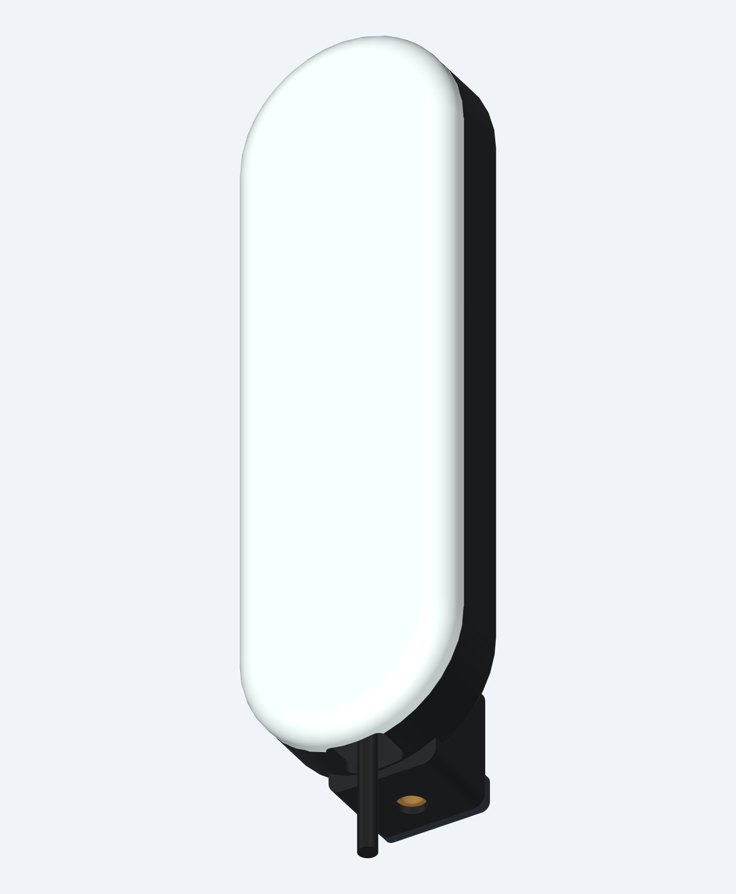
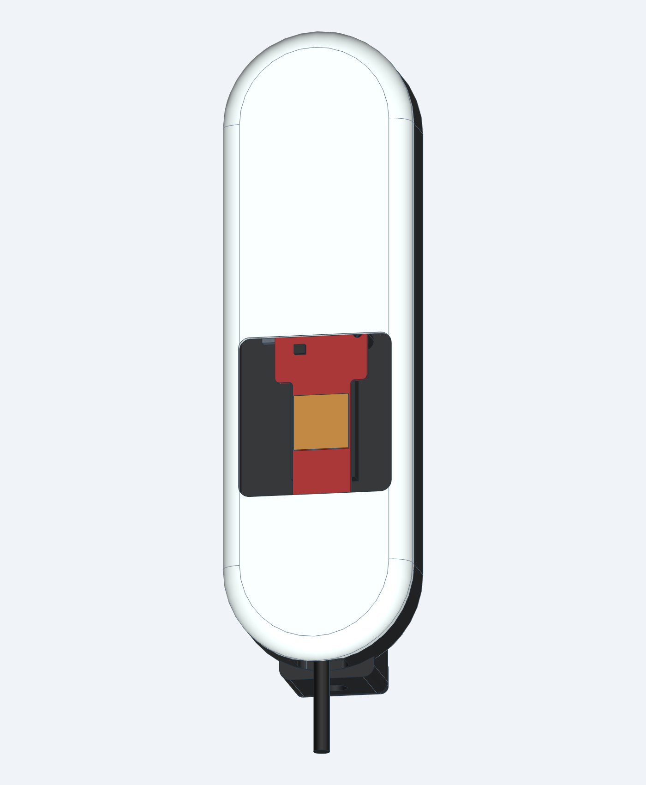

# Gasp

**A local Mac app and desktop radar enclosure for collecting personal silent-speech training data.**

Gasp Training Studio records radar takes from a **TI IWR6843AOPEVM**, guides you through calibration and reading scripts, and helps you review labels before training a personal phrase classifier. Capture over USB, or use **MMWAVEICBOOST + DCA1000EVM** for raw ADC data. The capture engine runs on the Mac without TI's capture GUI, a cloud account, or an API key.

**Training comes first. Transcription, text insertion, and radar predictions are disabled in the installed app.** Physical radar validation and real silent-speech accuracy are still pending. The simulator exercises the workflow; synthetic results provide no evidence of speech recognition.


## Get started

### Installed Mac app

Build a development app on an Apple Silicon Mac with Python 3.12, [uv](https://docs.astral.sh/uv/), and the Command Line Tools for Xcode:

```sh
git clone https://github.com/boyd-christiansen/gasp.git
cd gasp
uv sync --frozen --extra dev --extra macos-build
./scripts/build-macos.sh
./scripts/install-macos.sh
```

Open **Gasp** from `~/Applications/Gasp.app`. Its capture engine and runtime are bundled, so no Terminal window is needed after installation. This is an ad-hoc-signed development build; it is not Developer ID signed or notarized. See the [Mac app guide](docs/MAC_APP.md) for build details and permissions.

### Run from source

From the checkout, run:

```sh
./scripts/bootstrap.sh
./scripts/run.sh
```

Open **[the training workspace](http://127.0.0.1:8765/training)**. Alternatively, double-click [Start Gasp.command](Start%20Gasp.command). Keep the Terminal window open and stop it with Control-C. Dependencies stay in the project-local `.venv`, pinned by `uv.lock`.

The root page is an older research workbench. A source launch with `serve --research` explicitly enables its experimental phrase-classifier prediction tools; it does not enable transcription. The installed app keeps those tools disabled.

## Your first training visit

1. In **Session setup**, connect the **Simulator** to practice, or configure a physical source using the [hardware guide](docs/HARDWARE.md).
2. Create a **Personal calibration** visit. Save your participant name, distance, posture, and room notes. Paired collection records each speech prompt aloud and then silently as separate takes.
3. Optionally enable local reference audio. Start with the on-screen recording button; in the installed app, you can enable a **double tap of Right Option** after granting Input Monitoring. Tap once to finish or press Escape to cancel.
4. **Wait for the readiness sound and Recording indicator**, then perform the prompt. DCA capture arms before it is ready.
5. In **Review takes**, inspect the signal and loss figures, listen to reference audio when available, and confirm the words you actually performed. Keep repetitions and fillers. Use **Verify & keep**, or reject the take and try again. New takes are excluded from training until approved.
6. Move to **First phrase experiment** across separate visits. Reserve validation and final test visits, and use **Train baseline** with a whole-visit holdout. Use at least two approved examples of every label on each side, with the same participant, source, profile, and speech mode.

Scripts and visit progress survive restarts. Calibration includes stillness, movement, syllables, and vowels; it does not automatically calibrate a speech decoder or establish phonetic separability. See the [collection and evaluation plan](docs/EXPERIMENTS.md) and [app workflow](docs/MAC_APP.md#collection-plan).

## Hardware and capture options

| Source | Hardware and connection | Recorded signal |
|---|---|---|
| Simulator | Mac only | Clearly labelled synthetic fixtures for software checks |
| USB | IWR6843AOPEVM with compatible SDK 3.x OOB AOP firmware; command and data USB serial ports | Frame-averaged complex range/antenna heatmaps, not raw ADC |
| DCA1000 | **IWR6843AOPEVM + MMWAVEICBOOST + DCA1000EVM**; radar command USB and DCA Ethernet | Raw ADC packets plus decoded range FFTs; prompted takes up to 25 seconds |

USB and DCA data have different source/profile identities and cannot be pooled in one model. The app configures and starts/stops compatible hardware; firmware flashing and Mac Ethernet configuration are separate steps. Example RF profiles, DCA lane ordering, and physical signal quality still need board validation.

Start with [hardware bring-up](docs/HARDWARE.md): USB port selection, firmware compatibility, DCA wiring/network settings, raw capture/import commands, and timing limits.

## Printable enclosures

### Full capture stack · v1.2

The new tabletop enclosure holds **IWR6843AOPEVM Rev G + MMWAVEICBOOST Rev B + DCA1000EVM Rev A** together. It has an open radar window, a sculpted ripple cover with matching vents, indexed **0–40°** upward aim, cable tie stations, and a removable rear cable guide.

<p>
  
  
</p>

[Assembly and print guide](enclosure/capture_stack/README.md) · [Hardware counts](enclosure/capture_stack/HARDWARE.md) · [Cable routing](enclosure/capture_stack/CABLE_ROUTING.md) · [STEP/STL/GLB files](enclosure/capture_stack/exports) · [Check reports](enclosure/capture_stack/checks)

The repository includes parametric source, nine printable STL designs, assembly STEP/GLB files, renders, and checksums. Print the fit coupon first. Assembly exports contain non-printable board references; print the individual parts. The largest part is 214 × 195 mm in its supplied print orientation.

**These are CAD renders of an unprinted prototype.** Geometry and mesh checks do not establish physical connector fit, LVDS cable bending, stability, thermal performance, or RF behavior. Confirm board revisions and actual cables before a full build.

### Standalone USB enclosure

The smaller [IWR6843AOPEVM enclosure](enclosure/iwr6843aop/README.md) remains an alternative for the radar board alone. It has interchangeable solid-radome and open-aperture fronts and a captive ¼″-20 arm mount. It does not house the carrier/DCA stack.

<p>
  
  
</p>

## Data, labels, and training

Recordings stay local. The installed app uses `~/Library/Application Support/Gasp/Recordings`; the source workbench defaults to ignored `data/`. Raw UART or ADC files, exact radar configuration, timing/loss metadata, reviewed labels, and artifact hashes are retained. Reference audio is optional and is never an input to the radar classifier. There is no telemetry or automatic upload.

The first supervision is **confirmed text for the whole utterance**. Original prompts are preserved separately from reviewed transcripts. Audio/cue/radar alignment is software-based, with recorded uncertainty; word and phoneme timestamps are not fabricated. Hardware timing offsets remain to be measured.

The CPU baseline uses amplitude and phase-change features within a distance gate and a scaled logistic phrase classifier. Reports include accuracy, macro F1, a majority baseline, a confusion matrix, held-out visits, and trial hashes. Keep voiced, whispered, and silent takes separate, and include rest and realistic movement negatives. New session IDs alone do not make recordings independent visits.

This is closed-vocabulary phrase classification. Raw data is preserved for later sequence-model experiments; continuous dictation requires a much larger dataset and further research. The [experiment plan](docs/EXPERIMENTS.md) and [roadmap](docs/ROADMAP.md) describe those milestones.

## Documentation and development

| Guide | Contents |
|---|---|
| [Mac app](docs/MAC_APP.md) | Recording controls, calibration, review, local files, permissions, and app builds |
| [Hardware](docs/HARDWARE.md) | USB and DCA bring-up, capture formats, network setup, and CLI alternatives |
| [Experiments](docs/EXPERIMENTS.md) | Data collection, labels, splits, and evaluation |
| [Capture enclosure](enclosure/capture_stack/README.md) | Three-board assembly, printing, CAD rebuild, and mechanical sources |
| [Standalone enclosure](enclosure/iwr6843aop/README.md) | USB-only case, mounting, and CAD rebuild |
| [Firmware helper](firmware/README.md) | Optional host-tested packet encoder; not a built or flashed TI image |
| [Contributing](CONTRIBUTING.md) | Development checks and data-handling conventions |
| [Third-party references](THIRD_PARTY_NOTICES.md) | TI protocols, research, and implementation references |

```sh
uv sync --frozen --extra dev
uv run pytest -q
uv run python enclosure/iwr6843aop/checks/check_meshes.py
uv run python enclosure/capture_stack/checks/check_meshes.py
uv run python -m gasp doctor
```

Software checks cover UART framing/configuration, serial and UDP emulators, DCA reconstruction and loss accounting, capture/review/training, model provenance, the portable C encoder, and the packaged Mac workflow. They do not validate physical radar behavior, microphone alignment, or speech accuracy. Mechanical reports likewise describe CAD geometry and exported meshes.

Original project materials are under the [MIT license](LICENSE). Recordings, trained models, downloaded TI packages, purchase records, and local viewer logs are excluded from the public repository.

Inspired by [Subvocal](https://subvocal.company/preorder) and [Aarush Yadav’s announcement](https://x.com/AarushYadav47/status/2116198463847408066). Gasp is an independent project with no affiliation.
