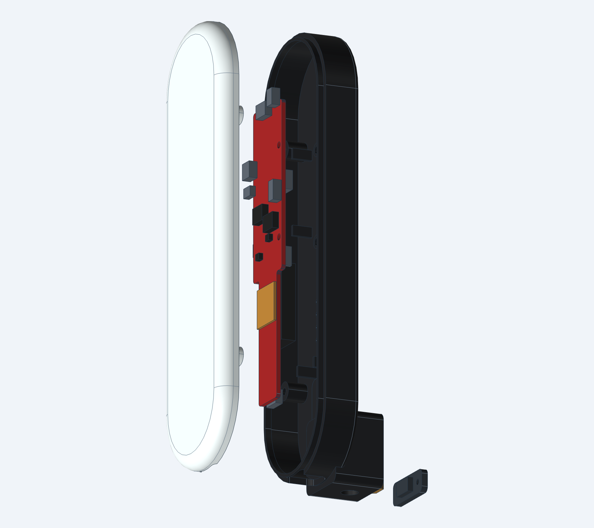

# Gasp

Gasp is a personal desktop radar research project. It pairs a local Mac workbench for **TI IWR6843AOPEVM** silent-speech experiments with a printable enclosure.

**New: [Gasp Training Studio for Mac](docs/MAC_APP.md)** — an installed, training-focused app with a menu bar, recording overlay, double-tap shortcut, personal calibration, resumable scripts, reference audio, explicit take approval and whole-visit baseline evaluation. **Transcription and text insertion are disabled.**

Capture complex radar signals over USB or raw ADC through **MMWAVEICBOOST + DCA1000EVM**, collect prompted trials with optional reference video/audio, review labels, train personal phrase models, and predict saved takes. Acquisition runs locally without TI's capture GUI, a cloud account, or an API key.

**Ready to exercise without hardware. Physical radar validation is still pending.** The simulator checks the software; its labelled synthetic waveforms are deliberately learnable and provide no evidence of speech recognition.

## Enclosure prototype

<p>
  
  
  
</p>

Parametric CAD, STEP/STL exports, assembled/exploded/interior renders, fit checks, and the [assembly and hardware guide](enclosure/iwr6843aop/README.md) are included. The two interchangeable fronts allow a solid radome versus open-aperture comparison. The rear has a captive metal ¼″-20 arm mount.

These are CAD renders of an unprinted Rev G prototype. **The current case supports standalone USB operation; the MMWAVEICBOOST/DCA stack needs connector access outside this closed case.** Physical fit, RF behavior, thermal performance and mount strength remain to be tested.

## Installed Mac app

The app bundles its capture engine and runtime. On this development Mac it is installed at `~/Applications/Gasp.app`. Open **Gasp**, choose **Session setup**, and practice with the clearly labelled simulator. Use **Personal calibration** first, then **First phrase experiment** across multiple visits. Recordings stay in Application Support and never enter this public repository.

To build your own Apple Silicon development app:

```sh
uv sync --frozen --extra dev --extra macos-build
./scripts/build-macos.sh
./scripts/install-macos.sh
```

See the [Mac app guide](docs/MAC_APP.md) for recording controls, optional microphone/Input Monitoring permissions, data review, timing limits, and build/signing status. The development bundle is ad-hoc signed, not notarized.


## Source workbench

Python 3.12 and [uv](https://docs.astral.sh/uv/) are recommended. On a fresh checkout:

```sh
git clone https://github.com/boyd-christiansen/gasp.git
cd gasp
./scripts/bootstrap.sh
./scripts/run.sh
```

Double-click **[Start Gasp.command](./Start%20Gasp.command)**. Keep its Terminal window open while using the workbench. Stop with Control-C.

Or, from this directory:

```sh
./scripts/run.sh
```

Open **http://127.0.0.1:8765/training** for the training workspace, or the root page for the older research workbench. Experimental classifier prediction endpoints are disabled by default; only a source launch with `serve --research` enables them. This does not enable transcription. Use Chrome for browser reference media. Dependencies stay in the project-local `.venv`; `uv.lock` pins the dependency graph. No global Python packages are changed. The optional CAD rebuild toolchain is documented separately in the enclosure guide.

## Without the board

1. Leave **Simulator** selected and connect.
2. Create a session and inspect the range/phase traces.
3. Edit the phrase deck, shuffle it, then record individual trials. Each trial has a three-second countdown.
4. Create another session to represent a different visit. Record at least two takes of each phrase on each side of the train/test split.
5. Review takes, correct labels or exclude bad recordings.
6. In **Train & evaluate**, choose whole training sessions and a separate test session. Train the CPU baseline.
7. For explicitly enabled research evaluation only (`serve --research`), classify a saved take or a matching USB window. This is a closed-set lab check; it never enables dictation or inserts text into other apps.

For an instant, bounded synthetic dataset:

```sh
.venv/bin/python -m gasp seed-demo
```

This creates three clearly labelled synthetic sessions for participant `synthetic-fixture`, with three labels and four takes per label. Refresh the dataset page. To try one of those models on the live simulator, create a simulator session using that same participant and radar profile. Real and synthetic datasets/models cannot be mixed.

## When the board is home

Read [the hardware bring-up guide](docs/HARDWARE.md). The fastest route is **existing SDK 3.x OOB AOP firmware → dual USB serial ports → this app**. There is no need to write custom firmware just to try the documented complex heatmap stream.

- Commands: 115200 baud; data: 921600 baud, 8N1.
- Start with `usb-phase-10hz`; try `usb-phase-20hz` after checking packet loss and phase continuity.
- Profile files are editable and checked for supported RF parameters, sampling timing and estimated UART throughput. **They are experimental, not board-validated.** A real board may require a compatible profile generated for its firmware/revision.
- The app requires SDK OOB framing. People Counting and vital-sign demos have different TLVs. A successful port open alone does not establish compatibility.
- The app sends acknowledged configuration commands and starts/stops acquisition. It does **not** flash firmware or change macOS network settings.

## What USB captures

The SDK 3.x AOP OOB demo can export **complex zero-Doppler range/antenna values** (TLV 8; legacy azimuth TLV 4 also supported). These are frame-averaged complex values, not raw ADC samples or a full radar cube. Magnitude-only range-profile TLV 2 is shown diagnostically but is not accepted as phase-sensitive training data.

The example 20 Hz profile uses 64 range bins and 12 virtual antenna channels, approximately 66 kB/s of the 92.16 kB/s available at 921600 baud. It has about 5.86 cm range-bin spacing. UART budget is a necessary check, not proof that the radar processing fits the frame period. Phase continuity and usable facial signal must be measured.

For raw ADC capture, disconnect USB acquisition and select **DCA1000 · raw ADC over Ethernet** in the app. The [DCA1000 guide](docs/HARDWARE.md#dca1000-fallback) covers the IWR6843AOPEVM + MMWAVEICBOOST + DCA1000EVM stack, Ethernet settings and USB command port. Each prompted take captures raw packets, stops the hardware and imports the take into the same review/training workflow. The app shows progress, supports cancellation, and retains raw ADC/manifest/configuration downloads. No mmWave Studio is required. DCA plots update after a take; continuous live decoding remains USB-only.

**DCA research prediction (requires `serve --research`; absent from the installed app):** train on matching DCA sessions, then use **Predict last completed DCA take**, or open any saved trial in Review and choose **Predict saved take**. The model receives radar only. The app verifies signal/model checksums and marks each result as a training playback, a take already in the held-out report, or new to this model. Scores are uncalibrated; replaying training data is not an accuracy measurement. Models are restricted to the same participant, source, profile and antenna layout. USB and DCA data cannot be silently mixed.

The default raw profile uses 50 ADC frames/s × 16 chirp loops, with burst timing preserved. This is not uniform 800 Hz sampling and has not been validated for speech. Start with a known reflector. An [optional C firmware packet encoder](firmware/README.md) is also included for a future narrower USB phase stream. It is host-compiled/tested, **not a built or flashed TI firmware image**.

## Dataset and timing

Everything is stored below `data/`, which is ignored by Git:

```text
data/
  sessions/<session-id>/
    session.json                 # participant, provenance, profile hash, notes
    radar.cfg                    # exact commands
    trials/<trial-id>/
      trial.json                 # label, quality, acceptance, checksums
      radar.npz                  # iq[T,range,antenna], monotonic timestamps, frame numbers
      uart.bin                   # original framed UART packets, when applicable
      reference.webm             # optional; MP4 on browsers that require it
  models/<model-id>/
    model.joblib
    report.json                  # exact trials/split/hashes, feature spec and metrics
  jobs/<job-id>.json
  raw/<session-id>/<recording-id>/
    adc.bin                      # DCA packet offsets reconstructed; holes reported
    manifest.json                # network, quality, timing, CLI acknowledgements
    radar.cfg
```

Camera and microphone remain off until you enable them. Reference media is local, optional, and never used by the baseline classifier. The browser/server clocks are related using a round-trip midpoint estimate; measured uncertainty and recording-start timestamps are stored. **This is software alignment, not frame-accurate hardware synchronization.** UART timestamps describe host arrival, not chirp emission. SDK frame numbers and CPU cycle counters are preserved in `uart.bin`.

Do not reuse the same visit as separate train/test sessions to inflate scores. The software enforces whole-session IDs, source, subject, profile and antenna layout, but cannot infer whether two session IDs were actually collected on different days. Collect silent, voiced and whisper takes separately. Include `rest` and realistic negative movements.

## Training scope

The runnable baseline uses log amplitude and complex phase increments within a configurable distance gate, resamples each take to a fixed representation, and fits a scaled one-vs-rest logistic classifier on CPU. Reports include accuracy, macro F1, majority baseline, confusion matrix, held-out sessions and per-trial SHA-256 hashes. Excluded takes and takes with over 5% UART frame loss are omitted. Missing labels in either split are rejected. Scores used for live rejection are **uncalibrated**, and should not be interpreted as measured reliability.

This is closed-vocabulary phrase classification, **not continuous dictation**. The raw data and manifests are retained for later temporal CNN/CTC/Transformer experiments. The early scientific milestone is repeatability across sessions, not a particular neural architecture. See [the experiment plan](docs/EXPERIMENTS.md).

## CLI

```sh
.venv/bin/python -m gasp doctor
.venv/bin/python -m gasp profile usb-phase-10hz
.venv/bin/python -m gasp replay data/sessions/SESSION/trials/TRIAL/uart.bin
.venv/bin/python -m gasp train --sessions TRAIN_SESSION TEST_SESSION --test TEST_SESSION
.venv/bin/python -m pytest -q
```

`--data PATH` before the subcommand selects a separate dataset root. `doctor` lists ports but does not open them. The workbench only binds loopback and rejects cross-origin browser requests. There is no public deployment or telemetry.

## Verified versus pending

Verified locally: fragmented UART framing and resynchronization, signed IQ ordering, actual pyserial reads/writes through OS pseudoterminals, configuration validation, prompted trial storage/review, synthetic holdout training, model provenance/checksums, browser capture workflow, DCA packet framing/reorder/gap accounting, synthetic ADC reconstruction, and the portable C encoder against the Python decoder. The DCA source also has integration tests using actual loopback UDP plus a serial emulator for repeated captures, cancellation, no-data failures, automatic import/review/training, raw downloads, and source switching. These fixtures provide no physical radar or speech-accuracy evidence.

Pending physical hardware: USB port/driver identities, board revision and firmware, RF profile acceptance, phase stability/SNR, custom firmware SDK integration and TI compilation, DCA Ethernet/FPGA/lane layout, actual camera/microphone permission and media alignment, and any real silent-speech accuracy.

## Technical sources

Implementation is original and based on documented wire formats; TI proprietary SDK/toolchain code is not bundled.

- [TI IWR6843AOPEVM](https://www.ti.com/tool/IWR6843AOPEVM)
- [TI SDK 3.5 user guide](https://software-dl.ti.com/ra-processors/esd/MMWAVE-SDK/latest/exports/mmwave_sdk_user_guide.pdf): SDK OOB CLI, AOP zero-Doppler complex heatmap export, UART and LVDS configuration. The URL's `latest` is an older 3.5 release; do not assume it selects 3.6.
- [TI SDK 3.6.2 LTS release notes](https://dr-download.ti.com/software-development/software-development-kit-sdk/MD-PIrUeCYr3X/03.06.02.00-LTS/mmwave_sdk_release_notes.pdf)
- [TI EVM hardware guide, SWRU546E](https://www.ti.com/lit/ug/swru546e/swru546e.pdf)
- [TI DCA1000 protocol](https://e2e.ti.com/cfs-file/__key/communityserver-discussions-components-files/1023/DCA1000-Protocol.pdf)
- [TI raw ADC capture format, SWRA581B](https://www.ti.com/lit/an/swra581b/swra581b.pdf)
- [mSilent research](https://wanhaoran.github.io/assets/papers/mSilent_final.pdf): motivation, not a claim that this baseline reproduces its system.

See [the research roadmap](docs/ROADMAP.md), [contribution notes](CONTRIBUTING.md), and [third-party references](THIRD_PARTY_NOTICES.md). Original project materials are available under the [MIT license](LICENSE). Recordings, trained models, downloaded TI packages, and local viewer logs are excluded from this repository.

Inspired by [Subvocal](https://subvocal.company/preorder) and [Aarush Yadav’s announcement](https://x.com/AarushYadav47/status/2116198463847408066). Gasp is an independent project with no affiliation.
