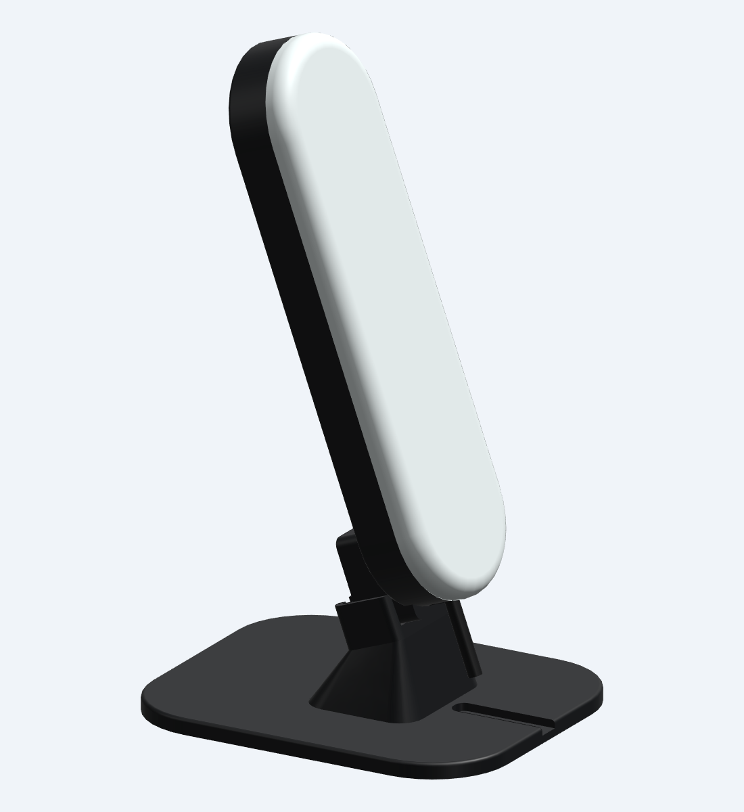
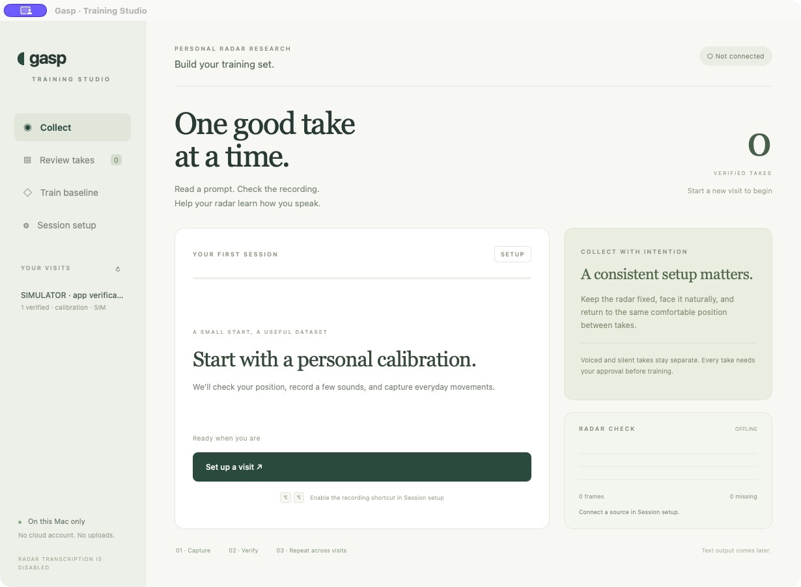

# Gasp

**Desktop radar experiments for personal silent-speech training.**

  
  

Two desktop prototypes: the **full capture stack** for IWR6843AOPEVM + MMWAVEICBOOST + DCA1000EVM, and the **single-board enclosure with its new desktop dock**. [Explore the hardware and print files →](docs/ENCLOSURES.md)

## Training Studio

Gasp is a local Mac app for recording radar data while you read or silently mouth scripts. It guides calibration, pairs optional reference audio with radar takes, and lets you review recordings before training a personal phrase model.

**This first version focuses on training data. Transcription and text insertion are disabled.** The enclosures are CAD prototypes, and physical radar performance and real silent-speech accuracy remain unverified.

## Get started with your first training visit

1. **[Install or launch Gasp](docs/GETTING_STARTED.md)** and connect the **Simulator** to practice without hardware.
2. Create a **Personal calibration** visit and choose aloud, silent, or paired collection.
3. Record a prompt after the readiness cue. Review what you performed, then choose **Verify & keep** or retake it.
4. Continue with **First phrase experiment** across separate visits, then train a baseline with a held-out visit.

The installed app supports a double tap of Right Option to record. Takes and reference audio stay on your Mac. The simulator checks the workflow; its results do not measure speech recognition.

## Learn more

Start with the **[documentation index](docs/README.md)** for setup and how-to guides:

- [Getting started](docs/GETTING_STARTED.md) — install, launch, and collect your first takes.
- [Using Training Studio](docs/MAC_APP.md) — controls, scripts, review, and local recordings.
- [Hardware and enclosures](docs/ENCLOSURES.md) — choose a build, print parts, and connect the radar.
- [Training and experiments](docs/EXPERIMENTS.md) — data collection, labels, and evaluation.
- [Contributing](CONTRIBUTING.md) — development and verification.

Original project materials are available under the [MIT license](LICENSE).

Inspired by [Subvocal](https://subvocal.company/preorder) and [Aarush Yadav’s announcement](https://x.com/AarushYadav47/status/2116198463847408066). Gasp is an independent project with no affiliation.
