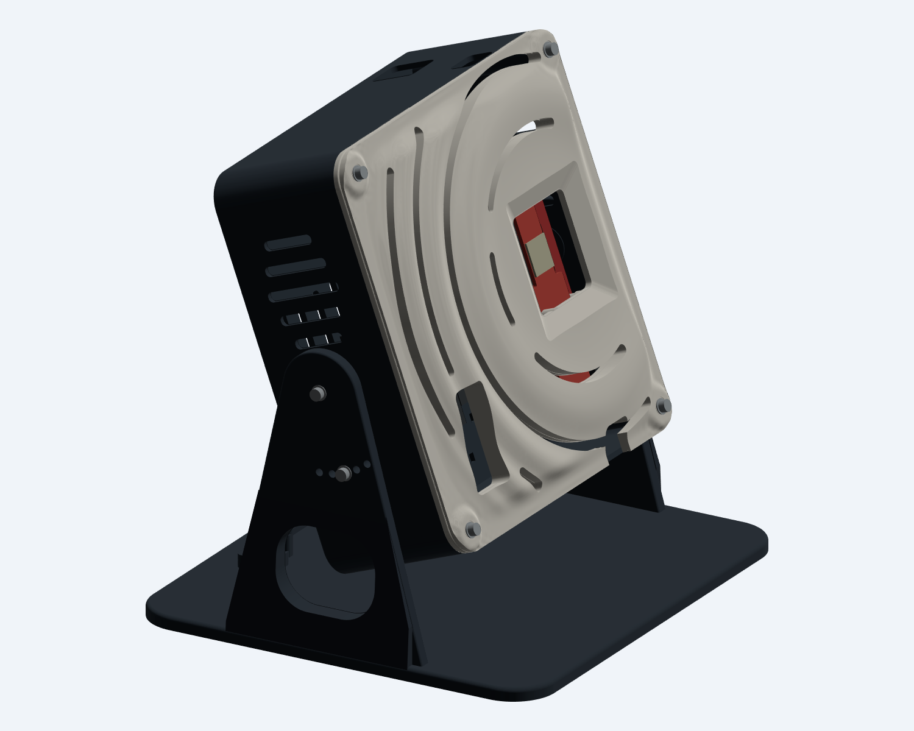
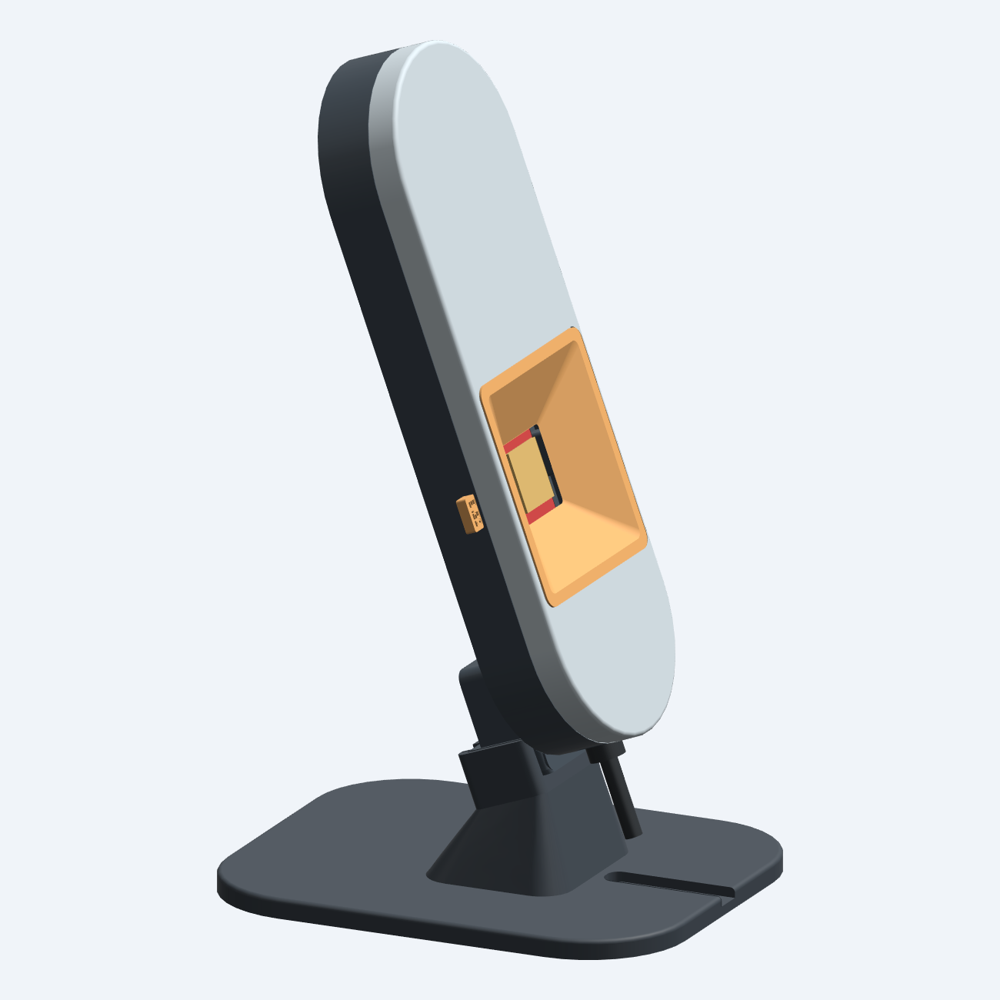
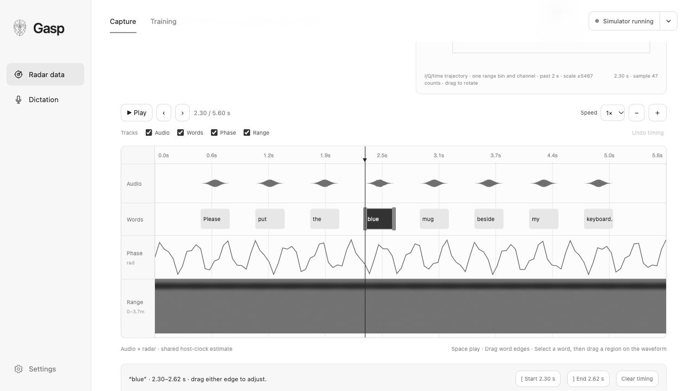

# Gasp

**Desktop radar experiments for personal silent-speech training.**

  
  

Two desktop prototypes: the **full capture stack** for IWR6843AOPEVM + MMWAVEICBOOST + DCA1000EVM, and the **single-board v2.2 enclosure with its fitted desktop mount**. [Explore the hardware and print files →](docs/ENCLOSURES.md)

## The app

Gasp is a local Mac app for recording radar data while you read or silently mouth scripts. It guides calibration, pairs optional reference audio with radar takes, and lets you review recordings before training a personal phrase model.

Guided capture, then a shared timeline for audio, words and radar. [See the review interface →](docs/COLLECTIONS.md#review-your-recordings) Screenshots use synthetic demo data.

**This first version focuses on training data. Transcription and text insertion are disabled.** The enclosures are CAD prototypes, and physical radar performance and real silent-speech accuracy remain unverified.

## Get started with your first collection

1. **[Install or launch Gasp](docs/GETTING_STARTED.md)** and connect the **Simulator** to practice without hardware.
2. Open **Personal calibration**, start a session, confirm your setup, and enter the recorder.
3. Follow the prompts: actions have a countdown and automatic stop; hold Space for speech. Review each take and choose **Verify & keep** or record it again.
4. Work through **First speech → Return & repeat → Independent check**. Then add your own collections and train a phrase baseline with held-out sessions.

The installed app supports a double tap of Right Option to record. Takes and reference audio stay on your Mac. The simulator checks the workflow; its results do not measure speech recognition.

## Learn more

Start with the **[documentation index](docs/README.md)** for setup and how-to guides:

- [Getting started](docs/GETTING_STARTED.md) — install, launch, and collect your first takes.
- [Using Gasp](docs/MAC_APP.md) — controls, scripts, review, and local recordings.
- [Hardware and enclosures](docs/ENCLOSURES.md) — choose a build, print parts, and connect the radar.
- [Training and experiments](docs/EXPERIMENTS.md) — data collection, labels, and evaluation.
- [Contributing](CONTRIBUTING.md) — development and verification.

Original project materials are available under the [MIT license](LICENSE).

Inspired by [Subvocal](https://subvocal.company/preorder) and [Aarush Yadav’s announcement](https://x.com/AarushYadav47/status/2116198463847408066). Gasp is an independent project with no affiliation.
