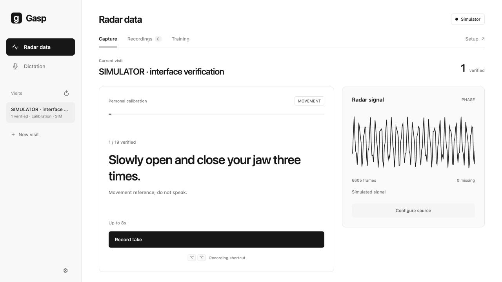
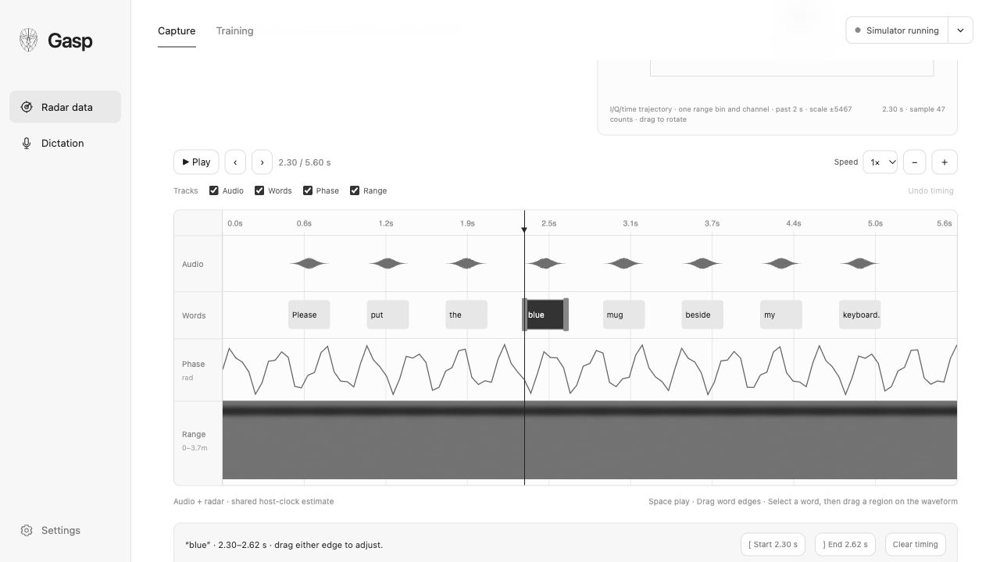

# Collecting with Gasp

Capture starts with four guided collections: **Personal calibration → First speech → Return & repeat → Independent check**. Select the current card, start a session, confirm your saved setup, then enter the recorder. Use a reference microphone for aloud speech.

Hold **Space** for speech or a series of movements, and release when finished. Only stillness/background samples use a three-second preparation countdown and a timed capture that stops automatically. Book passages and free capture use Space to start and finish. A session remembers your place; **Pause session** lets you stop and return later. Every twelve pending takes, Gasp offers a review break.

## Review your recordings

These screenshots show the current app interface with generated simulator signals and a synthetic reference waveform, not measured speech performance.

In review, audio, words, complex phase and range share one playhead. Click a timed word to seek; drag its edges or use arrow keys on an edge (50 ms, or 10 ms with Shift). To place an untimed word, select it and drag across its sound on the audio waveform, or use `[` / `]` at the playhead. Click the ruler or other tracks to scrub. On-device audio estimates and imported forced alignments still need review. Silent takes have their own timelines. Word timing is optional for accepting an utterance transcript. Actions have no transcript or word track.

**Verify & keep** counts a usable take. **Reject** makes its prompt available for another attempt. The guided baseline requires 472 reviewed takes across at least three independent sittings; this is an initial engineering protocol, not a promise that a dictation model is ready. Sentence material is original to this project. [Protocol and research rationale](design/COLLECTION_JOURNEY.md).

Once the baseline is reviewed, **New type** creates a named collection from Words & phrases, Sentence practice, Read a book, Position study or Free capture. “The Odyssey” is a collection made from Read a book. Recipes are read-only after creation. Open **⋯ → View collection definition** to inspect one. New sessions copy the definition and current placement; settings changes never rewrite previous sessions.

The recording sidebar groups collections, sessions and takes. Filter for sessions needing review or search their text, person and location. Session **Delete…** requires a warning and permanently removes its captures and annotations. Old soft-discarded records remain accessible in Settings → Storage.

## Radar and microphone

The status capsule opens Radar settings; its arrow also offers Disconnect. USB has a command port for configuration and a data port for radar frames. Phase at 20 fps is the default. Other profiles trade temporal resolution for Doppler or spatial diagnostics. Keep a collection’s source and profile consistent; resuming requires the original profile.

Position preview displays actual live range magnitude and, when the firmware emits them, spatial detections. It does not identify a face. DCA captures raw bursts for later review; continuous positioning preview is currently a USB feature. There is no automatic diagnostic-profile switch: choose a collection profile explicitly after inspecting spatial diagnostics. Simulated data is marked throughout and belongs to a separate cohort.

Microphone capture uses the input selected in macOS Sound settings. Native speech timing suggestions require an aloud reference recording and stay local. Collection review does not enable radar dictation or text insertion.

## Data and training

Progress is derived from accepted, reviewed takes for a person, source and exact radar profile. Each baseline role has stable step IDs. Paired utterances, metadata, raw captures, original scripts and annotation revisions remain on disk. Switching to DCA starts a separate cohort.

The current CPU trainer is a phrase classifier. For the new baseline it uses the repeated benchmark phrases and movement controls; the 120 distinct sentence pairs are retained for future sequence training. Development and final-test sessions cannot be used for fitting. A free capture needs reference audio and a manually confirmed transcript.

Existing sessions remain in history; Gasp does not relabel older data as completion of the new baseline. Hardware DCA layout, accurate sensor synchronization and real silent-speech performance still require physical validation.

### Capture checks and timing assistance

Stillness and typing/background samples are timed: press Space once to start a
three-second preparation countdown, followed by the recording countdown. Jaw, lip,
head-turn and swallowing prompts use hold-to-record with an elapsed timer and no
preparation delay. Release when the movement is complete. A storage limit of 60
seconds (25 seconds for DCA) remains; it is not a required duration. Both kinds of
action are reviewed without transcripts or word annotations.

The reference microphone stays warm while the recorder is open. A 300 ms buffer
stays in memory and is included only when a take starts; leaving the recorder
stops the input and clears that buffer. Gasp disables AVAudioEngine voice
processing. The input meter reports the macOS microphone mode; use Standard
rather than Voice Isolation for repeated syllables. The selected input and mode
are recorded with new audio references.

The start cue is a short tone. Its playback completion and an 80 ms decay margin
are recorded on the audio host clock. The microphone stays warm and the original
WAV is preserved, but quality checks, acoustic timing and on-device recognition
exclude everything before that boundary. The timeline shades this prefix and
playback opens after it. Processed recognition offsets are translated back to the
original audio/radar timeline. Older Pop-cue recordings use an explicitly marked
timing estimate; unverified automatic labels inside that prefix are re-drafted.
Human-edited and verified annotations are preserved. Bluetooth and room echo can
still affect acoustic latency; this is software timing, not hardware synchronization.

Capture checks flag missing/very quiet audio, uncertain syllable timing, audio
interruptions, clipping and missing radar frames before advancing. These are
heuristics, not proof that all prompted speech was captured. Listen and review.
Red timeline bands mark missing radar frames on the radar tracks only.

Aloud review automatically suggests word timing using on-device recognition,
matching recognized words to the existing transcript. Unmatched words remain
unplaced. Isolated syllable exercises can use acoustic peaks as draft boundaries;
these are labelled acoustic estimates, not forced alignment. Silent takes do not
inherit aloud timing. No timing suggestion is a verified annotation until reviewed.
Select a word and drag over its sound in the audio track, or drag existing span
edges. The [ / ] controls show the selected start/end and an unfinished start
marker. Punctuation separators are not annotation tokens.

To repeat calibration without deleting earlier data, open the collection's ⋯
menu and choose **Start a new session…**.
