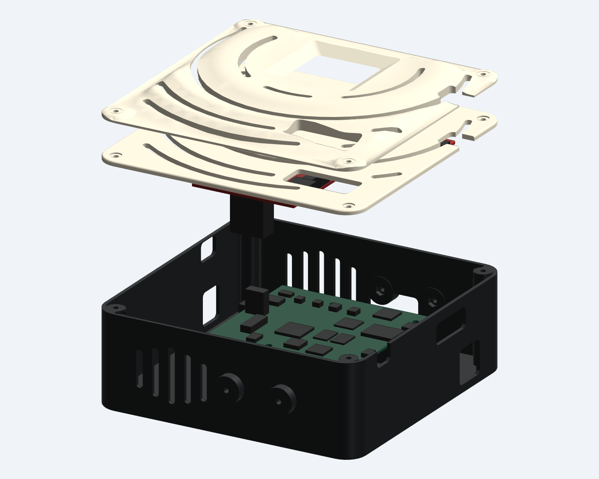
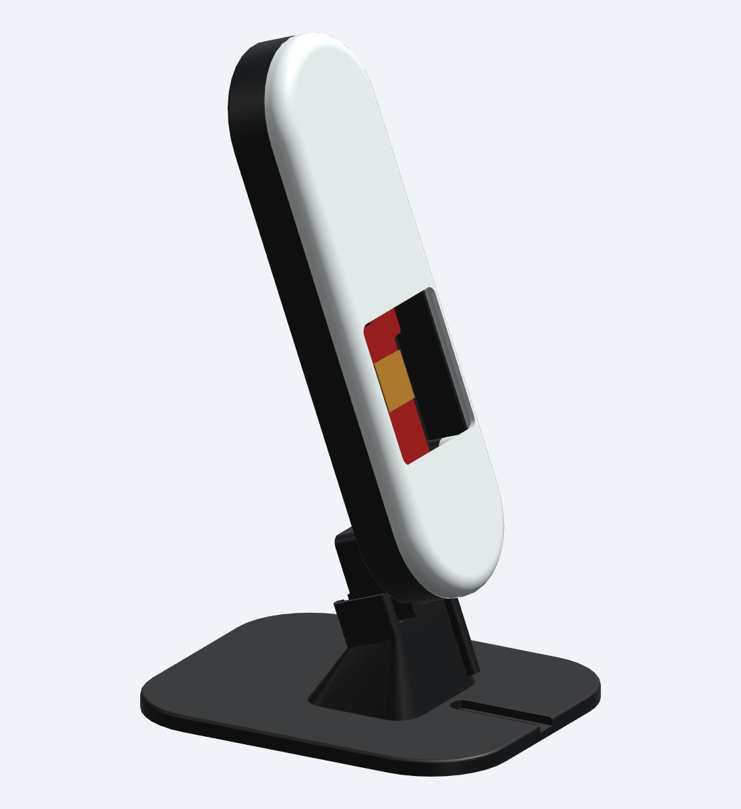

# Hardware and enclosures

[Documentation](README.md) · [Hardware bring-up](HARDWARE.md)

Choose a capture path and enclosure below. These are unprinted CAD prototypes: physical connector fit, cable bending, stability, thermal performance, and RF behavior still need validation. Print a fit coupon before the large parts, and print individual part files rather than display assemblies.

## Capture options

| Source | Hardware and connection | Recorded signal |
|---|---|---|
| Simulator | Mac only | Clearly labelled synthetic fixtures for software checks |
| USB | IWR6843AOPEVM with compatible SDK 3.x OOB AOP firmware; command and data USB serial ports | Frame-averaged complex range/antenna heatmaps, not raw ADC |
| DCA1000 | IWR6843AOPEVM + MMWAVEICBOOST + DCA1000EVM; radar command USB and DCA Ethernet | Raw ADC packets plus decoded range FFTs; prompted takes up to 25 seconds |

USB and DCA data have different source/profile identities and cannot be pooled in one model. Example RF profiles, physical lane ordering, and signal quality still need board validation. [Follow the connection guide →](HARDWARE.md)

## Full capture stack

The v1.2 tabletop enclosure holds **IWR6843AOPEVM Rev G + MMWAVEICBOOST Rev B + DCA1000EVM Rev A** together. It has an open radar window, sculpted ripple cover with matching vents, indexed 0–40° upward aim, cable tie stations, and a removable rear cable guide.

  
  

- [Assembly and printing](../enclosure/capture_stack/README.md)
- [Hardware counts](../enclosure/capture_stack/HARDWARE.md) and [cable routing](../enclosure/capture_stack/CABLE_ROUTING.md)
- [STEP/STL/GLB files](../enclosure/capture_stack/exports), [parametric source](../enclosure/capture_stack/src), and [check reports](../enclosure/capture_stack/checks)

There are nine printable STL designs; the largest part is 214 × 195 mm in its supplied print orientation. Assembly exports include non-printable board references. The supplied short LVDS cable's installed bend remains to be checked with the actual boards.

## Single-board enclosure and desktop dock

The smaller **IWR6843AOPEVM v1.2** enclosure is for standalone USB capture. It has interchangeable solid-radome and open-aperture fronts, printed PCB washers, standard 2.5 mm cable-tie slots, and a captive metal ¼″-20 arm mount. It does not house MMWAVEICBOOST or DCA1000EVM.

  
  

The new **drop-in desktop dock** holds either front at a fixed 20° upward aim. It uses a smooth locating pin and heel cradle, needs no additional metal hardware, and has a USB cable groove. The enclosure rests under gravity and lifts out along the pin axis; it has no latch or threaded lock.

- [Enclosure v1.2 assembly and printing](../enclosure/iwr6843aop/README_v1_2.md), [hardware list](../enclosure/iwr6843aop/HARDWARE_v1_2.md), and [enclosure print files](../enclosure/iwr6843aop/exports_v1_2)
- [Desktop dock guide](../enclosure/iwr6843aop/DESKTOP_STAND.md), [dock print files](../enclosure/iwr6843aop/exports_dock), and [dock manifest](../enclosure/iwr6843aop/DESKTOP_STAND_MANIFEST.json)
- [Parametric source](../enclosure/iwr6843aop/src) and [fit/mesh reports](../enclosure/iwr6843aop/checks)

The dock footprint is 100 × 120 mm. Print the optional cradle-fit sample first and check the actual nut, rear retainer, and cable. The original [v1.1 enclosure guide](../enclosure/iwr6843aop/README.md) and exports remain available for reference; use the v1.2 files for the current build.
