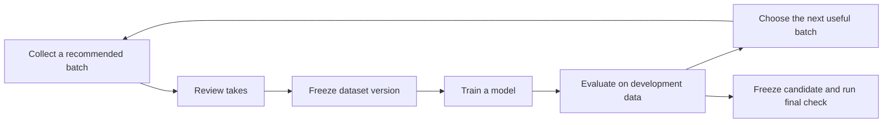

# Training journey: from the first recordings to personal dictation

**Implementation update — 0.7.0:** Frozen datasets, the Training workspace, local phrase runs, a CTC worker, portable job/result exchange and follow-up capture assignments are implemented. Live rack submission, adaptive curriculum, uncertainty estimates and streaming dictation remain future work. See the [current training guide](../TRAINING.md).

Original proposal · 1 November 2026 · retained as the design rationale; see the implementation update above.

[Collection journey](COLLECTION_JOURNEY.md) · [Current training implementation](../TRAINING.md)

## Product decision

Capture answers **“What do I record now?”** Training answers **“What have we learned, and what should I collect next?”** They share one program and the same recording records. A collection remains a reusable recording recipe; it does not become a model or an experiment.

Keep the four-step onboarding already in progress. Build a continuing dictation curriculum behind it, driven by measured performance. The phrase experiment diagnoses the instrument and gives us a first model; recognizing eight phrases is not the destination and does not establish dictation capability. Conversely, disappointing results from one simple classifier do not establish that the sensor contains no useful information.

The initial target is **Boyd silently mouthing ordinary, previously unseen English at his desk, with a fixed radar and push-to-talk boundaries**. Whispering, completely motionless internal speech, other people, other rooms, and automatic continuous listening are separate conditions. Full-text dictation can begin with push-to-talk; an always-listening detector need not block the first useful decoder.

This proposal changes neither existing collection definitions nor progress. A new acquisition profile or protocol gets a new version. Existing data remain inspectable and potentially useful for diagnostics or explicit transfer experiments.

## What exists, and what is missing

Audited against source commit `c32ccb7`:

| Available now | Required next |
|---|---|
| Versioned collection recipes, setup snapshots, reviewed transcripts, original signals, annotation revisions, articulation modes and reserved roles | Immutable, reusable dataset snapshots that also pin annotation revisions, preprocessing and split membership |
| Four baseline steps, 472 takes across calibration, training, development and final-test roles | Continuing sentence curriculum, coverage reports and explicit links from evaluation to collection |
| CPU logistic phrase classifier, whole-session holdout, quality checks, confusion matrix and model reports | Separate development and final-test evaluation, temporal phrase model, sequence trainer and text metrics |
| A local background training task with queued/running/complete/failed files | Durable run records, cancellation, restart reconciliation, checkpoints and an optional Slurm runner |
| Training screen with per-session fit/holdout selectors and range settings | A guided model overview, dataset inspection, useful results and comparison |

The current trainer skips sentence examples and rejects reader collections. Its interface combines development and final-test data into one “held out” category. It must not silently reinterpret old reports as three-way experiments.

The existing baseline contains only **60 distinct paired training sentences**, plus 30 development and 30 final-test sentences. Most of its 472 takes are repetitions, references, controls or evaluation examples. It seeds dictation research; it is not a substantial dictation corpus.

## Evidence informing the plan

- **Radar precedent:** [mSilent](https://doi.org/10.1145/3580838) demonstrates sentence decoding with TI radar and a learned temporal architecture. Its authors explicitly discuss unseen sentences as a limitation of their corpus and decoder. Its headline result is therefore not our open-text success criterion. See the [author manuscript, §9](https://wanhaoran.github.io/assets/papers/mSilent_final.pdf).
- **Data growth and silent articulation:** the [SoniSpeech preprint](https://arxiv.org/html/2608.00803v1) reports 18,000 voiced/silent utterances, 26.7 usable hours in total, and 26.3% silent word error with combined training. Voiced-only training performed substantially worse on silent evaluation; its scaling curve was still improving. This is acoustic sensing on glasses, not desktop radar, so it supports the collection strategy without giving us a radar data minimum.
- **A better baseline matters:** a [2025 IR-UWB preprint](https://arxiv.org/html/2509.26409v1) reports 91.1% versus 74.0% word accuracy for a learned temporal model versus conventional features under leave-one-session-out evaluation. This supports testing temporal representations before interpreting a weak feature classifier as a sensing limit.
- **Utterance labels are sufficient to start:** [CTC](https://docs.pytorch.org/docs/2.15/generated/torch.nn.CTCLoss.html) sums over alignments between the signal and transcript. Word boundaries are optional supervision, not a prerequisite for training. The [official EMG silent-speech implementation](https://github.com/dgaddy/silent_speech) is a useful engineering reference for text decoding and paired recordings, with a different sensor modality.

Our proposed collection budgets below are engineering checkpoints, not published thresholds or promises of accuracy. Product demonstrations and the older command-word paper do not establish either the ceiling or sample requirements of Gasp.

## The curriculum

### 1. Complete the existing baseline; train as data arrive

Keep calibration, First speech, Return & repeat, and Independent check intact. Training can prepare datasets during collection and run the first fit once First speech is reviewed. Its early training-set result is labeled a pipeline check. Return & repeat supplies development results. Independent check stays reserved until a candidate is frozen.

Do not wait for hours of data to exercise the training pipeline. First overfit a small training-only subset to catch broken labels, timing, tensor layouts and loss computation. That check is diagnostic and never displayed as generalization accuracy.

### 2. Validate the acquisition path before scaling it

Run a small, matched USB/DCA study: the same reference movements and short speech material, repeated in independent sittings, with the acquisition order counterbalanced. Record the time cost and inspect actual facial response, packet loss, phase continuity and timing. Fit comparable diagnostics within each profile. Do not pool profiles or require simultaneous USB/DCA acquisition that the current stack does not support.

USB currently provides 10/20 Hz complex summaries. The bundled DCA profile supplies 50 frames/s with 16 chirp loops in bursts; this is not uniform 800 Hz sampling. Validate lane order, channels, timestamps and usable temporal detail on the physical DCA stack. Review profile changes before committing the main corpus to them. See [hardware details](../HARDWARE.md).

This is a gate on a large time commitment, not a reason to discard today's USB pilot. A stronger temporal model, timing checks and a duration-only baseline help distinguish weak acquisition from weak modeling.

### 3. Grow natural connected speech in useful increments

| Milestone | Cumulative reviewed silent **training** signal | Purpose |
|---|---:|---|
| Sentence pilot | 30 minutes | Exercise a sequence model, discover systematic recording problems and establish initial development errors |
| First learning curve | 2 hours | Compare several training-data subsets on the same development set; test whether more data improves new-text recognition |
| Personal corpus | 5 hours, then 10 hours | Expand vocabulary, coarticulation, sentence structure and day-to-day variation |
| Further expansion | 20+ hours if justified | Continue when learning curves and acquisition checks support it; revise the approach if they do not |

These totals exclude development/test recordings, voiced references, controls, rejected takes, breaks and review time. At an illustrative six seconds per accepted utterance, two silent training hours is about 1,200 utterances. The app must estimate wall-clock effort from the user's observed pace rather than presenting signal hours as work hours.

The default next task is a **10–15 minute collection session**, resumable in short review blocks. Each session produces both accepted-duration progress and a count of distinct text. The recorder continues to use hold/release for short speech and movements, timed capture for background samples, and start/stop for passages. Prompt duration is not a demand to stretch speech.

Starting speech-content mix, by accepted duration:

- 60% varied contemporary sentences: messages, explanations, questions, contractions, dates, numbers and ordinary dictation.
- 25% book or longer-prose passages, split at sensible sentence boundaries within the capture path's limits.
- 15% personally useful language and targeted practice prompted by development errors.

The proportions are initial policy, not a research result. Add brief repeated anchor phrases and rest/movement controls separately; they must not inflate the silent-speech total. Keep some anchors across days to measure drift while emphasizing new text in the main corpus. Audit pronunciation-based phone and phone-pair coverage to find missing contexts, but do not claim that text coverage proves the radar distinguishes those sounds.

Initially retain voiced/silent pairs throughout the small sentence pilot. Afterward, compare silent-only and combined training before reducing voiced references to a sampled subset; a provisional one-in-three paired schedule can reduce effort if the ablation supports it. Mode batches should remain small enough to avoid fatigue. Pair IDs link content, never copied word timestamps. A reference microphone can help verify aloud text; it cannot transcribe silent intent.

Use original or appropriately licensed source text with provenance. Book-only training would miss much everyday language. Free voiced capture remains useful supplementary material; silent free capture requires the person to supply and confirm intended text. Review should emphasize utterance correctness and signal quality, with detailed word alignment reserved for debugging or a particular experiment.

### 4. Strengthen evaluation as the corpus grows

The baseline's 30 development and 30 test sentences are early diagnostics. Before the two-hour milestone, provisionally grow each to **250 distinct sentence takes across at least three independent sittings**, retaining their original roles. Count these separately from training hours. Six-second utterances would be about 25 minutes per set, before voiced references and review. Treat confidence intervals and sitting variation as evidence for whether this is sufficient, not the number 250 alone.

Freeze evaluation version 1 before comparing the two/five/ten-hour models. New evaluation data create a new version; comparisons require all candidates to be scored on the same version. Hold out new text as well as acquisition sittings. Keep a later position/room challenge set separate so its difficulty does not obscure progress under the initial desk condition.

Training recommendations may use development errors, coverage deficits and observed quality. They cannot mine the final test for prompts. Once test errors guide development, retire that set to development and collect a fresh final test. Custom collections unlock when the existing baseline is collected, independent of model score. Continued recommended collection and the custom library coexist afterward.

## Training tab: one overview with progressive detail

Retain **Capture** and **Training** as the two radar tabs. Do not add a second curriculum wizard, experiment dashboard, permanent dataset sidebar, or grid of hyperparameter cards.

The main Training screen is a calm model overview:

1. **Header:** Personal dictation, with the current person and acquisition profile as compact context. The eight-phrase check appears as the current milestone inside that program. Technical recipe and compatibility details are under the existing overflow/detail pattern.
2. **Current milestone:** one short explanation, actual progress, and one primary action. Depending on state: “Continue collecting,” “Review recordings,” “Train first model,” “View training,” or “Compare result.” A specific issue links to the affected recordings, not a generic failure page.
3. **Data summary:** reviewed silent duration, distinct utterances and independent sittings. “View dataset” opens role counts, collection filters, rejected/missing material and the snapshot definition. Voiced/control duration stays available in detail.
4. **Latest result:** initially phrase discrimination; later word error on new sentences, sample count and evaluation version. A small learning curve appears only when comparable runs exist. Before a result exists, show no fabricated chart or model-readiness percentage.
5. **Recent runs:** compact rows with name, state, dataset version and result. Full history and logs open on demand.

One main page scroll. Reuse the app's black/white styling, spacing and status patterns. Color supplements labels. Empty, blocked, queued, disconnected, failed and completed states receive the same design attention as the successful state. Dense diagnostic plots are drill-downs.

### Starting training

“Train first model” opens a concise preparation sheet:

- task and versioned default recipe;
- actual eligible training/development counts, with final test visibly reserved;
- execution destination, resource limit and estimated duration only when measured;
- one “Start training” action.

Splits default from the collection protocol. The user should not classify every session with a dropdown. “View dataset” supports subsets by collection, sitting, articulation and conditions. Excluding data creates a new snapshot, with an explanation of lost coverage. Protected evaluation data cannot casually be moved into fitting. Range gates, tokenizers and model parameters belong in an advanced recipe editor that creates a new immutable version.

Choosing a personal rack runner makes the data transfer explicit. Radar tensors, reviewed transcripts and manifests suffice for the initial model. Reference audio is transferred only for an explicitly selected teacher experiment. Capture remains local and there is no automatic upload or telemetry.

### While a run is active

Show preparation, queued, training and evaluating as real states. Display epoch/step progress, development error and a measured time estimate when available. Cancellation stops the job and preserves useful checkpoints. Closing/reopening Gasp must reconcile the job's true state: local interrupted runs are marked interrupted; Slurm runs can continue independently and reconnect. A lost network connection is not a failed GPU job.

Keep collection usable during remote training. Local work must be resource-limited and kept from disrupting radar/audio capture. A run trains on its frozen snapshot; later edits and new recordings do not change its inputs halfway through.

### Reading a result

Default to three things: result on the development set, change from a comparable run, and representative errors. Each error shows intended text, predicted text, differences and a direct link into the existing radar/audio timeline. The linked review context distinguishes frozen training annotations from later corrections. Training audio playback is a review tool, never a decoder input.

For the phrase check, report macro F1, per-phrase recall, control confusions, a majority baseline and a duration-only baseline. For sequence models, report word error rate (WER), character error rate (CER), insertions/deletions/substitutions and per-sitting results. Show counts and uncertainty; a small test cannot support precise claims. Report silence/negative emissions separately. False activations per hour require actual timed background evaluation, not just isolated control classification.

Always compare raw radar decoding before language-model correction. A separately identified corrected result can be useful later, but must not conceal poor sensing. Include shuffled/no-signal checks to expose language or duration shortcuts. Do not compare WER across changed evaluation sets as if a model improved.

“Check final model” is a deliberate action after model/decoder selection is frozen. It creates a separate final-test report and records access. Results do not silently enable Dictation. A later candidate preview should require measured on-Mac latency, rejection behavior, editing burden and performance on fresh dictated text.

## How Capture and Training stay connected

Use a versioned **collection assignment** behind the scenes: collection definition, acquisition cohort, intended dataset role, content IDs, target and reason. A Training recommendation creates or resumes one of these assignments in Capture. The destination uses the existing collection card, setup, recorder and review; no separate training recorder is built. Capture completion updates the same progress evidence that Training reads.

Start with understandable rules: insufficient reviewed signal → collect/review; repeated losses → inspect acquisition; missing language contexts → new sentence batch; day-to-day performance drop → independent repeat; improving development curve → more varied text. Surface one recommendation with a short reason. Adaptive sampling needs an exploration share and must avoid turning the corpus into repeated examples of a few errors.

## Reproducible data and model contracts

Add these objects without replacing the existing session/take storage:

- **Dataset snapshot:** IDs and hashes of original artifacts; exact annotation revisions and reviewed text; trims and cue exclusions; articulation; source/profile/firmware/channel layout; collection/version; pair/content/source-document IDs; physical acquisition groups; quality exclusions; train/development/test memberships; preprocessing/tokenizer versions. Freeze before submission, not after fitting.
- **Recipe:** task, input representation, normalization, tokenization, architecture, optimizer, augmentation, seeds and resource envelope. Fit learned preprocessing on training data only. Preserve original transcripts alongside versioned normalization for numbers, punctuation and case.
- **Run:** snapshot/recipe/source commit/container digest, destination, scheduler job ID where applicable, timestamps/events, metrics, checkpoints and terminal state. Checkpoint optimizer, scheduler, random state and sampler position for meaningful resume.
- **Evaluation:** model hash, evaluation dataset/version, decoder, normalization, predictions, metric denominators, uncertainty and intended scope. Development and final-test reports remain distinct.
- **Recommendation:** originating development report, reason, proposed collection assignment and fulfilled progress. Recommendations never mutate historical recipes or labels.

For open-text evaluation, group voiced/silent pairs, retakes and derived windows together. Detect duplicated or near-duplicated sentences and overlapping passages, and partition books by content groups rather than adjacent windows. Also keep independent acquisition groups disjoint. Repeated diagnostic phrases deliberately occur across splits for the closed-vocabulary task; they are a separately reported benchmark, not evidence of novel-text recognition. Common words across sentence splits are expected.

The dataset registry can record all three roles, but routine training workers receive only training and development payloads. Final-test material is staged separately for the deliberate evaluation job. Neither pretrained-teacher adaptation nor fitted normalization/tokenization may consume the reserved test recordings or transcripts. A generic externally pretrained model is distinct from fitting on our own evaluation text; record its provenance as well.

Quality and deletion remain intelligible. A snapshot lists exactly what was excluded and why. A later corrected annotation creates a new candidate snapshot. Deleting source recordings warns which datasets/runs become non-reproducible and prevents new runs on missing inputs; it must not secretly preserve an undeletable data copy. Completed reports retain their historical provenance and are marked when source material is unavailable.

## Modeling sequence

1. **Reproducible CPU phrase check.** Preserve the existing classifier as a named recipe; repair three-way evaluation and add meaningful controls. Train a small temporal classifier on the same data as the first neural comparison.
2. **Temporal radar encoder plus CTC.** Retain range/channel/time structure, phase and amplitude information, masks and actual timing. Begin with a small convolutional/temporal model and character or small-subword targets. Use reviewed whole-utterance text. Do not resize every utterance to the phrase baseline's fixed 64 time steps.
3. **Compatible acquisition and loss.** Check effective output length against token length and adjacent repeated tokens before fitting. At 20 Hz, aggressive temporal downsampling can make CTC alignment impossible. Subword targets can ease that constraint but cannot restore missing sensor information. Do not silently mask impossible losses or treat interpolation as a higher measurement rate. Process DCA's within-burst and between-frame timing explicitly; raw-derived features are a separate recipe.
4. **Controlled comparisons.** Vary data amount, representation and voiced/silent supervision on fixed development data. Use fixed subset seeds, log multiple model seeds for promising candidates, and checkpoint learning curves. Avoid a large hyperparameter sweep on a tiny corpus.
5. **Teachers and stronger decoders.** Once the plain radar-to-text path works, compare voiced audio teacher representations, optional video if a separate capture feature is justified, larger temporal encoders and sequence decoders. Teachers may use training-only paired data; audible speech and known prompts stay unavailable at radar-only inference. Do not copy voiced timing onto silent samples.
6. **Local product candidate.** Export and benchmark on the actual Mac. Test new messages, correction effort, time after release and empty-input behavior. Streaming/context and continuous DCA capture are later engineering work; the existing burst recorder is not a continuous dictation service.

CTC and evaluation rules are grounded in the linked documentation; the architecture ordering and sizes are proposals. A phoneme auxiliary task can be tested, but a long isolated-phoneme drill should not become the main route to connected dictation.

## Compute proposal

Use the Mac for collection, review, small CPU phrase fits and final inference tests. Start neural work with **one scheduled GPU node** on the personal rack; use the second node for independent comparisons when available, before adding distributed training.

The [DGX Spark hardware guide](https://docs.nvidia.com/dgx/dgx-spark/hardware.html) describes an ARM64/Blackwell system with 128 GB unified memory. Shared CPU/GPU memory and framework compatibility need explicit testing; capacity is not a measured training-speed promise. Confirm the live specifications, available memory, partitions, project instructions and container catalog for both the Spark and ASUS GX10 before selecting a node or submitting work. The rack was not reachable from the Mac's selected network during this planning pass, so no live capacity or runtime was verified.

Provisional scheduling envelopes, to revise after a benchmark:

| Work | Initial resource request | Bounded wall time |
|---|---|---|
| Small local phrase baseline | 2 CPU threads; measured memory limit | Minutes, measured on the actual dataset |
| GPU compatibility and tiny-subset fit | One node/GPU allocation, 4 CPU workers, 32 GiB host/shared memory ceiling | 30 minutes |
| Compact temporal/CTC pilot | One node/GPU allocation, 8 CPU workers, 64 GiB host/shared memory ceiling | Up to 4 hours |
| Larger comparison | Increase to at most 96 GiB only if live capacity and measurements permit | Up to 8 hours with checkpointing |

These are proposed job limits, not runtime predictions or reservations. Begin with a modest encoder (roughly 5–20 million parameters as an experiment), benchmark a representative batch and use measured throughput/peak memory to size full runs. Test supported mixed precision, CTC, FFTs and checkpoint restore inside a compatible ARM64/Blackwell PyTorch container pinned by digest. No speculative multi-node or large language model provisioning is needed for the first experiment.

All GPU work, substantial preparation/builds and model services run in Slurm under the assigned daily identity, using a named Gasp workspace and pinned rootless containers. Read `cluster-context`, `/etc/rack-cluster/AGENTS.md`, the project instructions and current ownership records first. Keep workload processes inside the allocation, honor existing services, and link source commits, job IDs, manifests and verified artifacts. The app submits/reconciles jobs through a runner adapter; no always-on GPU endpoint is required.

At the current DCA profile's approximate 2.46 MB/s, ten recorded hours is about **89 GB of ADC payload**. If ten silent hours are fully paired aloud, ADC alone doubles; controls, holdouts, retakes, decoded arrays, feature caches, checkpoints and backups add more. A provisional **0.5–1 TB project allowance** is sensible for the early raw-data program, subject to actual artifact sizes and free capacity. A changed profile requires recalculation. Keep originals and an independently verified backup; local caches/scratch are not the backup. Public Git stores code, plans and sanitized examples, not recordings or trained personal artifacts.

## Build order and acceptance criteria

1. **Dataset and evaluation foundation.** Add a read-only readiness summary and immutable snapshots. Preserve existing roles; separate fit, development and test; validate paired/content/acquisition grouping. Prove that annotation edits, exclusions and rejected inputs cannot alter a running experiment, and that legacy reports remain accurately labeled.
2. **Training overview and CPU path.** Design the empty/collecting/ready/running/result states before wiring them up. One useful action per state, automatic default membership, dataset detail and a result linked to the existing timeline. Demonstrate the entire loop on synthetic fixtures, then on the real baseline with synthetic results clearly separate. Never convert a quota into “model ready.”
3. **Sequence dataset and local training harness.** Export variable-length tensors/masks/text without audio inputs. Audit CTC lengths, tensor ordering and normalization. Pass a tiny training-only overfit check, reproducible reload, a controlled invalid-input check and separate-development evaluation. Integrate WER/CER and per-example predictions into the same run/result contract.
4. **Rack runner.** Verify live access and resources; benchmark within Slurm. Add content-hashed transfer, queued/running states, logs, cancel, checkpoint/resume and reconnection. Validate an interrupted transfer, application restart and job failure without losing provenance or claiming a job succeeded.
5. **Continuing curriculum.** Add the 30-minute/two-hour assignments, corpus provenance/coverage, fixed evaluation enlargement and explicit links back to Capture. Recommendations use development only. Retain the custom library and existing capture interactions. Measure actual time and review burden before setting larger assignments.
6. **Learning curves and candidate comparison.** Run controlled data-size comparisons; inspect natural-language errors and acquisition drift; decide whether to scale collection or change the sensing/model path. Full Dictation activation is a later, measured product decision.

The first delivery should complete steps 1–2 and define the shared contracts needed by step 3. That makes Training useful while the baseline is being collected, without waiting for remote GPU integration or pretending the phrase model already does dictation.
