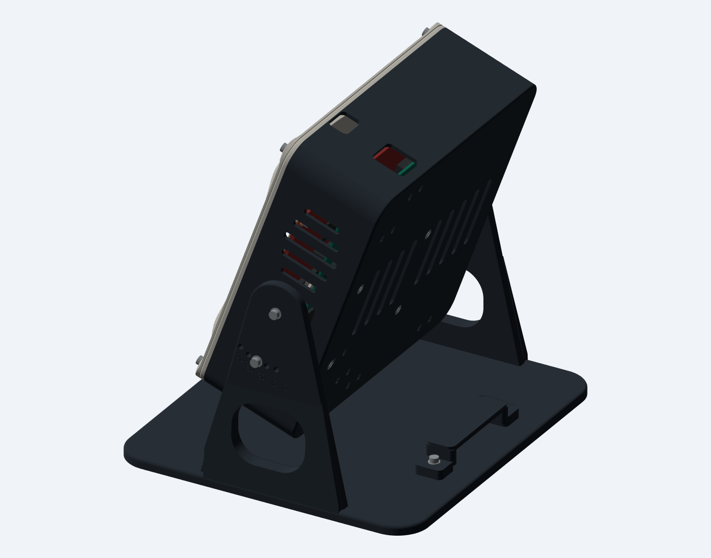

# Cable routing — v1.2

The rear guide gathers the leads into one exit behind the unit. The electronics and their connectors tilt together; the guide stays on the desk base. Leave a relaxed loop between those two moving and stationary attachment points.

## Ports

| Location | Connection | Opening in the rear shell |
|---|---|---|
| Bottom, near radar side | DCA Ethernet | 24 × 23 mm, rounded |
| Bottom, middle | Two carrier USB leads | 35 × 14 mm, rounded |
| Bottom, opposite radar side | Carrier power lead | 16 × 13 mm, open at the front seam |
| Top, nearer rear face | DCA power | 20 × 22 mm, rounded |
| Top, nearer front face | Optional AOP data USB | 18 × 13 mm, rounded |

Both front layers retain aligned access openings for the carrier power plug and optional lower AOP connector. The side service opening remains accessible. Match the connections and power configuration to TI's instructions; the openings do not imply every USB or power connection should be used simultaneously.

## Route and retain

1. Feed the purchased 2.5 mm ties through the paired slots before installing the PCBs. Keep the flat strap against the inside rear floor and the bulky tie heads outside. Six tie stations are available; use only the ones needed for your active connections.
2. Bring the DCA power lead from its top port around the back, then down the side nearest that port. Two tie stations beside the rear grille keep this run against the housing. The top pair can retain the lead nearer its connector. Keep the central ventilation slots unobstructed as much as practical.
3. Bring the lower Ethernet, carrier USB and power leads out through their individual openings. The lower tie stations give strain relief on the moving shell. Retain the cable jackets gently; do not compress connector boots or force a sharp bend at a plug.
4. Bring the leads behind the housing and lay them between the two pads on the base. Load the guide nuts from the underside, then fit the removable bridge over the bundle using two M3 × 12 screws and two metal washers. The nominal passage is **52 mm wide × 12 mm high**. A **48 × 11 mm** rectangular bundle gauge clears the actual CAD. It is a loose guide, not a cable clamp. Remove it to change cables without passing their plugs through a tunnel.
5. Support the housing and try all five tilt settings before tightening the ties. At each setting, the leads must stay slack, clear the side pivots and index screws, avoid being trapped under the case, and exert no pull on the connectors. Set loop length and bend radius using the actual cables; their bend limits and molded boots are not fully modeled.

The guide and enclosure clear each other at 0°, 10°, 20°, 30° and 40°. The housing's lowest modeled point is about 29.6 mm above the desk at 20°. That clearance is for routing flexible leads; do not put rigid adapters or a tightly folded bundle underneath it.

The short internal Samtec LVDS cable still connects the two large boards inside the housing. Do not route it through the external guide. Its end orientation and installed bend remain a physical fit check.

## What was checked

Ten generic straight plug/lead gauges clear the new openings. Every tie station has a checked 15 × 2.5 × 1.2 mm internal strap envelope clear of the vendor component boxes. Guide contact, fastener bores, nut insertion, full nominal nut engagement, bundle clearance and interference at all five tilt settings are checked in the included reports. The image shows the actual CAD without hypothetical cable shapes; the final flexible routing must be set during assembly.
