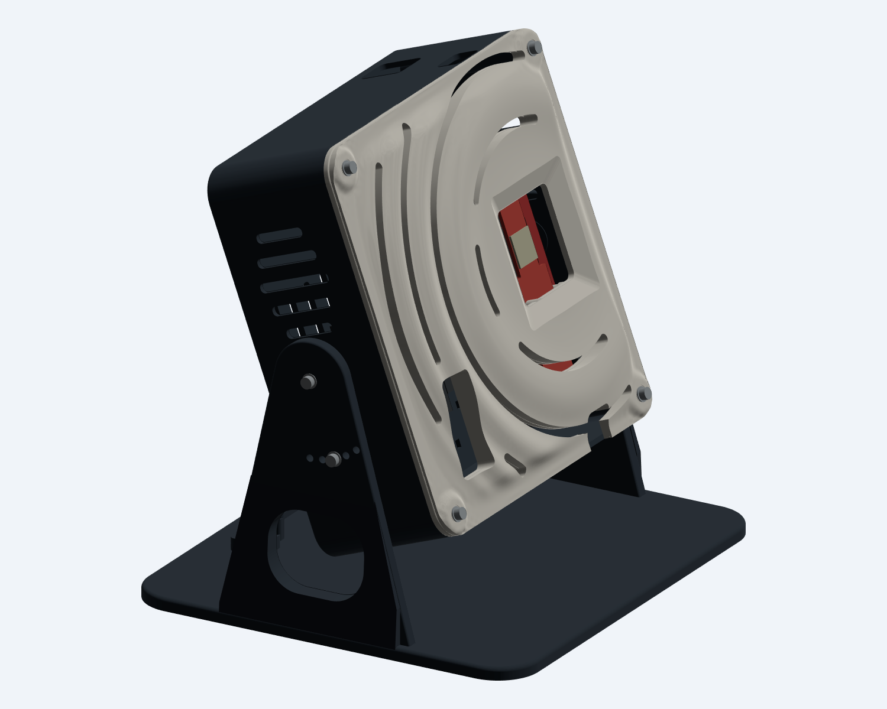
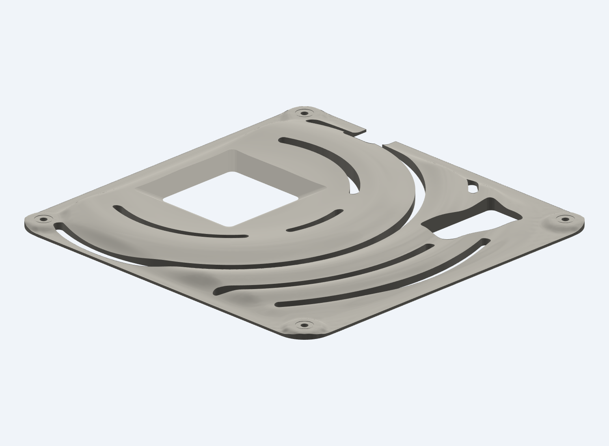
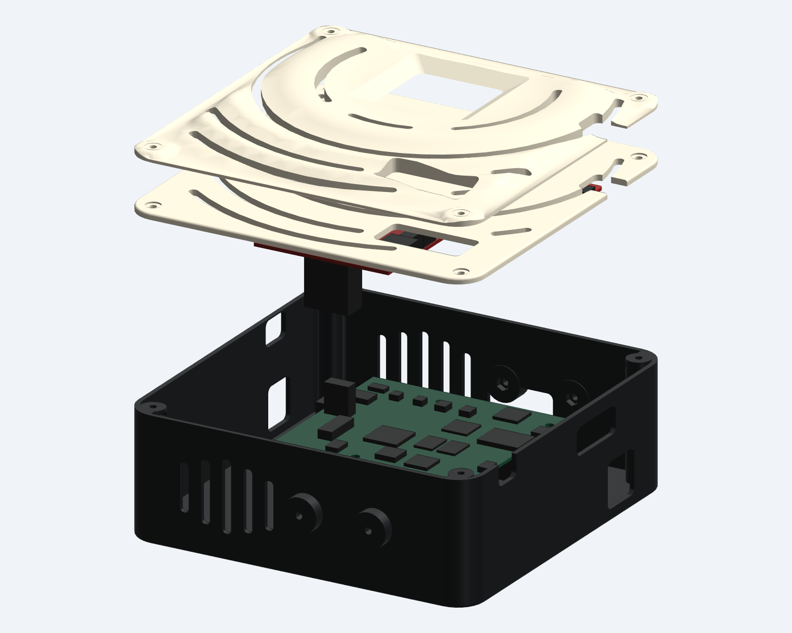

# Tabletop capture enclosure — v1.2

A printable, ventilated enclosure for **TI IWR6843AOPEVM Rev G (PROC091G), MMWAVEICBOOST Rev B (PROC074B), and DCA1000EVM Rev A (PROC048A)**. See the [hardware list](HARDWARE.md) for M2/M3 fasteners and inserts. The radar faces through an open window, with no plastic membrane in front of its antenna package.

The v1.2 front adapts a **solid water-droplet sculpture**, with its ripples centered on the radar chip. Its original profile is preserved in [the bundled reference source](references/ripple_panel_original.py). Seven curved ventilation slots follow the rings through both front layers. A separate sculpted cover adds up to approximately **7.65 mm** above the structural front and prints with its flat back down. The central spire is replaced by the open radar window, which flares outward through the relief.

The rounded charcoal-and-ivory shell, rounded stand crowns and foot edges, hidden carrier nuts, cable ports, six tie stations and removable rear cable guide are retained. Colors are a filament suggestion; each part is a single-material print. See [CHANGELOG.md](CHANGELOG.md) and [CABLE_ROUTING.md](CABLE_ROUTING.md).

The electronics tilt together on a broad tabletop base. Two pivot screws and two separate locking screws give positive settings of **0°, 10°, 20°, 30°, and 40° above horizontal**. The locking screws carry the angle load; the design does not depend only on friction at the pivots.



## Start here

1. Print `exports/fit_coupon.stl` and check the M3 nut pocket and M2 insert fit.
2. Print one rear shell, one structural front bezel, one ripple cover, one table base, one cable guide, and the washer quantities below.
3. Assemble initially at **20°**. At a horizontal radar-to-mouth distance of **548.6 mm (1.8 ft)**, the modeled centreline reaches **336 mm (13.2 in) above the desk**. Adjust placement and angle to your seated position.
4. Check the physical board revisions, fully seated radar connector and short LVDS cable route before tightening the enclosure.

This is an engineering prototype checked against vendor mechanical data. It has not been physically printed or assembled, load tested, thermally characterized, or RF tested. Those checks remain necessary before treating it as a finished instrument enclosure.

## Files and printing

| Print file in `exports/` | Quantity | Print orientation / size |
|---|---:|---|
| `rear_shell.stl` | 1 | Rear face on bed, open side up; 192 × 180 × 62.5 mm including side bosses |
| `front_bezel.stl` | 1 | Already oriented with outside face on bed and posts up; 180 × 180 × 13.73 mm |
| `ripple_cover.stl` | 1 | Flat back on bed, sculpted ripples up; 180 × 180 × 7.65 mm |
| `table_base.stl` | 1 | Flat foot on bed, cheeks upright; 214 × 195 × 138 mm |
| `cable_guide.stl` | 1 | Already oriented on its rear edge; 90 × 12 × 18 mm |
| `dca_washer_1p8.stl` | 4 | Flat; Ø7 × 1.8 mm |
| `carrier_washer_0p8.stl` | 4 | Flat; Ø7 × 0.8 mm |
| `radar_washer_0p6.stl` | 2 | Flat; Ø4.4 × 0.6 mm |
| `fit_coupon.stl` | 1 | Flat; test piece only |

STEP files accompany the print files. `assembly_20_degrees.step` and `.glb` include **non-printable electronics and fastener references**. Do not print the assembly. The displayed spread of parts is an illustration of separate print jobs, not a single arranged printer plate.

Print the ripple cover separately from the structural front so the sculpture faces up and the board-support posts also face up in their own print. The cover has a nominal 1.2 mm flat backing, blended perimeter and flat corner washer seats. The STL uses a finer 0.02 mm export tolerance to preserve the shallow curves. Layer lines will still be visible on a physical print. The smooth cover preview is `ripple_cover.glb`.



A usable bed of about **220 × 220 mm** accommodates the largest part without a wide brim. Suggested first prototype: PETG, 0.20 mm layers, 5–6 walls, 6 top/bottom layers, and approximately 35–40% infill. Use solid washers. The front prints with its flat outer-face land on the bed; its 1.2 mm perimeter fillet rises from that land. The rear floor prints flat. The base has 20 mm plan-view corner radii, a 2 mm top-edge fillet, and rounded 18 mm stand crowns with 1 mm edge fillets. Inspect the slice under the stand openings; their short flat roofs bridge about 16 mm. The guide is already rotated onto an edge so its cable passage does not require a 52 mm bridge. Horizontal screw holes and short nut-pocket roofs bridge small spans; inspect the slice and clear any sagging before assembly. The paired USB port has an approximately 29 mm roof span; use accessible local supports there if your printer cannot bridge it cleanly. Avoid supports trapped inside nut pockets. Keep the heat-set insert posts solid with a local infill modifier if needed.

The coupon's three blind holes, from left to right with the nut pocket on the right, are 2.9, 3.0 and 3.1 mm. The enclosure uses the 3.0 mm pilot for 3.2 × 4 mm M2 inserts. If your printer needs a different fit, change `M2_BORE` and regenerate; do not force an oversized insert into a cold post.

## Assembly

All dimensions below refer to the modeled configuration. See [HARDWARE.md](HARDWARE.md) for exact screw counts.

1. **Prepare the front.** Heat-set the two M2 inserts into the smaller posts from the board side, flush with their contact faces. Let them cool completely before bringing a PCB near them. Slide four M3 nuts into the side-entry pockets in the ICBOOST posts from their negative-Y sides. Their flats align with the slots. The nuts are concealed below the outer skin; install them before the PCBs.
2. **Attach the radar to the front.** Place the AOP board on its two small contact lands, component/antenna side facing the open window. Fit the two 0.6 mm printed washers and M2 × 6 screws from the back of the PCB. The narrower data-USB end points toward the top of this housing; the wider power-only end points down. The screws clamp the PCB to printed lands, not to nearby components.
3. **Mate ICBOOST.** With the front face resting flat, bring ICBOOST into place behind the AOP board and mate AOP **J2** to carrier **J4**. Check connector seating by hand before fastening. Use four 0.8 mm printed washers and M3 × 12 screws from the back of ICBOOST into the front's captive nuts. The nominal distance from the carrier's front PCB face to the radar's rear PCB face is **5.0 mm**. Do not pull a partially seated connector together with the mounting screws. If the physical spacing differs, update `MATE` and the fastener stack before using the housing.
4. **Prepare the rear.** Load four M3 nuts into the rear-face DCA pockets, four into the side-loaded closure columns, and four into the inside-facing pivot/lock pockets. The closure nuts slide in with their flats aligned to the loading slot. The two remaining pairs have open hex recesses for access while the enclosure is open.
5. **Attach DCA1000.** Set it on the four rear-shell standoffs. Use four **1.8 mm printed washers** and **M3 × 25** screws. Its PCB is supported 21.5 mm from the outside rear face, leaving space for the Ethernet jack and other underside components.
6. **Connect and route cables.** Connect the supplied Samtec cable between DCA J3 and ICBOOST J10. The DCA connector is offset above the carrier edge to give the cable a route around that edge. Gently bring the shell halves together while checking the cable stays clear of the PCB edge, bosses and front panel. Dedicated bottom ports serve Ethernet, the paired carrier USB leads and carrier power. Separate top ports serve DCA power and optional radar USB. Feed the 2.5 mm ties before fitting the boards, with tie heads outside the housing. Route the DCA power lead down the back using the two right-side tie stations. See [CABLE_ROUTING.md](CABLE_ROUTING.md) for the route and slack checks.
7. **Close the enclosure and fit the ripple cover.** Seat the structural front against the rear shell. Lay the sculpted cover flat against that front, with the matching radar opening, cable openings and vent slots aligned. Use four **M3 × 16** screws with metal M3 washers on the cover's recessed corner seats, through both layers into the corner-column nuts. These four closure screws are longer than in v1.1; the ICBOOST mounting screws remain M3 × 12. Snug the screws without bowing either PCB or crushing printed posts.
8. **Fit the stand.** Place the enclosure between the cheeks. Use one M3 × 16 plus metal washer at each pivot. Align the pair of **20°** index holes and install the other two M3 × 16 screws plus washers into the locking bosses. Snug all four. To change the angle, support the enclosure, loosen the pivots, remove both locking screws, select matching holes on both sides, reinstall and tighten.

9. **Fit the cable guide.** Load two M3 nuts from the underside of the base, up into the pockets below the guide pads. Lay the cable bundle between the pads; install the guide with two M3 × 12 screws and metal washers. The guide retains the bundle without compressing it. Keep slack between the moving housing and this stationary guide.

The bottom cable ports are above the tabletop at every indexed angle. Keep cable pulls off the unit. The bare printed foot is not a non-slip surface; place it on a stable, level desk and verify stability with the actual connected cables.

## Aiming and antenna coordinates

The angle labels describe the **radar normal above horizontal**, not the board's angle to the table. At 20° the radar is about 136 mm above the desk. Turn the whole base on the desk to set azimuth, and line up the **radar window** with your mouth; the window is about 43 mm to the right of the case centre. Start with your face toward the sensor.

The board is fixed in roll, with its long axis vertical. In the CAD cassette frame, +X is right, +Y is up the board plane, and +Z points out through the window. In the tabletop assembly the sensor normal is `(0, -cos(pitch), sin(pitch))`; the user is toward -Y. Preserve or explicitly transform this pose in processing rather than silently swapping azimuth and elevation channels.

The referenced [mSilent paper](https://wanhaoran.github.io/assets/papers/mSilent_final.pdf), §§4.1 and 6.2, used an **IWR1843 at 77 GHz with DCA1000**, and performed beamforming in the vertical direction. This housing adapts the capture concept to your **60 GHz AOP three-board setup**. AOP has a different virtual antenna layout and phase/sign corrections, so the paper's IWR1843 antenna map is not interchangeable with it. See [TI SWRU546E §4.5](https://www.ti.com/lit/ug/swru546e/swru546e.pdf) for the AOP array. No claim of reproducing mSilent performance is made by the mechanical design.



## Design checks and remaining fit checks

`checks/design_report.json` records validity, watertight B-rep boundaries, component-envelope clearances, PCB support contact, contact between the front layers, shell contact, shaft clearance, nut insertion paths, nominal thread engagement, and collisions at all five indexed angles. The open window clears a modeled ±60° pyramid extending 30 mm outward from the entire 15 mm antenna-package face, including through the added sculpted cover. This is a geometric check, not an RF measurement.

Nominal engagement is **2.4 mm through each M3 nut**, and **3.7744 mm in each M2 insert**. The modeled insert is intentionally larger than its heat-set pilot. All nine delivered STL meshes also pass checks for closed edges, consistent winding, connected surfaces and positive volume. `checks/stack_and_cables_report.json` checks the two larger boards against one another, the reserved heatsink space, ten generic plug/cable envelopes, and 1.2 mm of internal clearance for each tie strap. The cable-guide passage is checked with a 48 × 11 mm bundle gauge; the guide and shell clear one another at all five tilt settings. The LVDS connector body centres are 36.3 mm apart; this is a reach check against the nominal 50.8 mm cable, not proof of the cable's installed bend or end orientation.

`checks/ripple_report.json` compares 15 native surface samples with the preserved source profile, checks concentricity about the chip, and verifies that all seven vent paths are open through both layers. The profile samples agree within 0.05 mm. Seven other print meshes are byte-identical to v1.1: the rear shell, stand, cable guide, three washer designs and coupon.

Board locations come from official TI geometry, with component bodies represented by conservative boxes. The full STEP components of DCA1000 were used to extract its envelope and hole coordinates; the displayed references are simplified.

Before a final build, confirm your board revisions, actual connector seating height, heatsink size, the ribbon's end orientation/bend, the straight plugs, and print tolerances. The factory AOP heatsink is reserved as a 21 × 21 × 4.5 mm rear envelope. Do not alter the factory board or heatsink to make the enclosure fit. The boards' switches and required operating configuration remain governed by TI's guides. Ventilation is passive; verify temperatures under your actual capture duty cycle.

## Parametric source

`src/capture_enclosure.py` contains the models and source-derived transforms. `src/water_profile.py` preserves the profile functions from the author's solid water-impact sculpture; an unmodified copy is included as `references/ripple_panel_original.py`. Rebuilding this enclosure uses the bundled profile and compact vendor geometry, without depending on another local project or downloaded vendor archives.

The wave profile is scaled 1.35× in the plate plane and 0.55× in height, centered on the chip at cassette coordinates (42.8958, 2.4089) mm, and blended into the rounded perimeter and fastener lands. A cubic surface fitted to a 2 mm grid gives real three-dimensional relief. The reference's central spire is removed by the antenna opening. `RIPPLE_XY_SCALE`, `RIPPLE_Z_SCALE`, `RIPPLE_BACK`, and `RIPPLE_PAD` control this adaptation.

To rebuild and export using the installed CAD tool:

```sh
~/.local/bin/cadgen +0.8.4 run enclosure/capture_stack/src/capture_enclosure.py
~/.local/bin/cadgen +0.8.4 run enclosure/capture_stack/checks/check_design.py
~/.local/bin/cadgen +0.8.4 run enclosure/capture_stack/checks/check_stack_and_cables.py
~/.local/bin/cadgen +0.8.4 run enclosure/capture_stack/checks/check_ripple.py
~/.local/bin/cadgen +0.8.4 run enclosure/capture_stack/src/exports.py
~/.local/bin/cadgen +0.8.4 run enclosure/capture_stack/checks/check_meshes.py
```

Important mechanical parameters are `MATE`, `M2_BORE`, `IC_BACK`, `DCA_BACK`, `DCA_DX`, `DCA_DY`, and `PIVOT_H`. Changing board spacing, position or cover seating thickness requires rerunning fit checks and rechecking screw lengths and cable reach. Small parts and export files are kept separate for printing. Use the v1.2 structural front and ripple cover together, with M3 × 16 outer closure screws and M3 × 12 ICBOOST screws. The rear shell, base, guide, washers and coupon can be reused from v1.1.

Mesh checks need only Python: `python enclosure/capture_stack/checks/check_meshes.py`. From this enclosure directory, `shasum -a 256 -c SHA256SUMS.txt` verifies the published files. The optional vendor-inspection utilities require separately downloaded TI archives in their documented local paths; they are not needed to rebuild from the included geometry.

## Mechanical sources

- [TI SWRC355D / MMWAVEICBOOST design package](https://www.ti.com/lit/zip/swrc355): PROC074B Altium ASCII and fabrication drawing, 70.000 × 134.620 mm board, 69.71 mil nominal thickness.
- [TI SPRR350A / DCA1000 design package](https://www.ti.com/lit/zip/sprr350): PROC048A STEP, nominal 102 × 90 mm PCB; the STEP thickness is 1.5937484 mm.
- [TI SPRR418A / AOP design package](https://www.ti.com/lit/zip/sprr418): PROC091G board geometry reused from the earlier enclosure.
- [TI SWRU546E](https://www.ti.com/lit/ug/swru546e/swru546e.pdf): carrier connection §2.5; Rev G AOP mounting §4.8.3; antenna layout §4.5.
- [TI DCA1000 guide SPRUIJ4A](https://www.ti.com/lit/ug/spruij4a/spruij4a.pdf): board assembly, ports and original Samtec cable.

This directory includes compact extracted geometry and source links, rather than redistributing the large vendor design archives or the paper.
