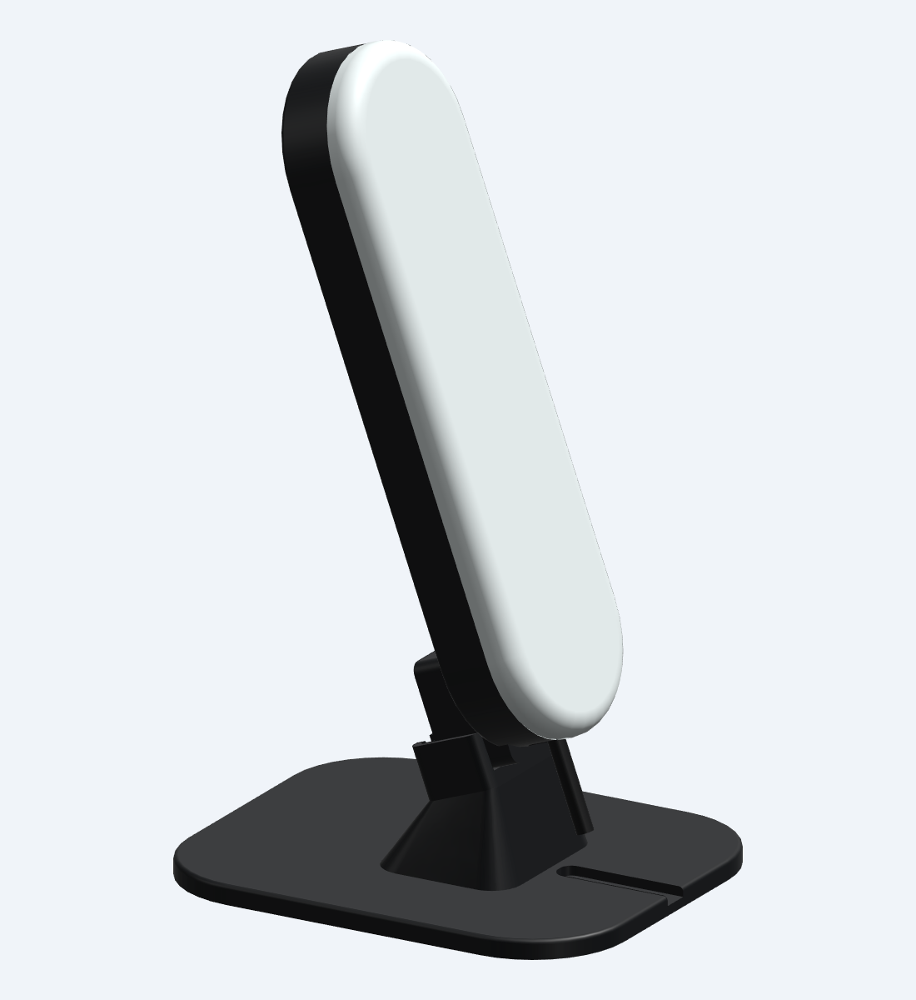
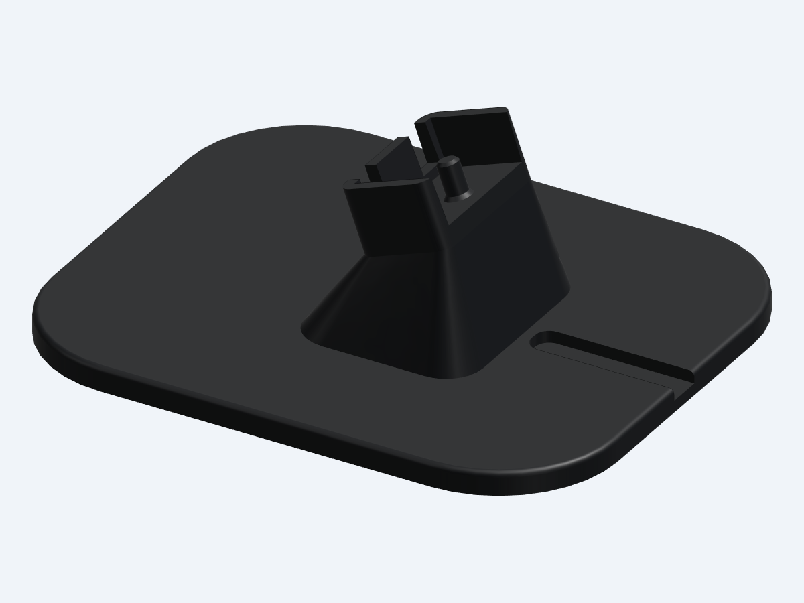

# Single-board tabletop dock — prototype v1.0

One printed stand for the **IWR6843AOPEVM pill enclosure v1.2**, with either front fitted. The existing downward-facing ¼″-20 mount sits in a shallow cradle. A smooth pin slides inside the captive metal nut to locate the enclosure; the cradle supports its heel and limits rotation. **The enclosure rests in the dock under gravity and lifts out along the pin axis. It does not screw in or lock.** No additional metal hardware is needed.



## Print files

| File | Print quantity | Purpose |
|---|---:|---|
| `exports_dock/desktop_dock_20deg.stl` | 1 | Complete stand, already oriented with the foot on the bed |
| `exports_dock/optional_cradle_fit_test.stl` | Optional 1 | Small sample of the actual cradle and pin; not needed in the finished assembly |

Matching STEP files are included. `assembly_on_dock` and `assembly_open_on_dock` are display/reference assemblies containing the enclosure and simplified electronics; do not print them as one piece. The existing enclosure print files are unchanged and are supplied in the separate v1.2 enclosure package.

Start with the small fit test if you want to check your printer's fit before printing the full foot. It is 32.8 × 19.8 × 14 mm. It should slide onto the enclosure's heel without force, with the metal nut and retainer already installed. The coupon is printed upright; the final cradle is tilted, so actual surface finish can differ slightly.

## Dimensions

| Feature | Modeled value |
|---|---|
| Stand footprint | 100 × 120 mm; rounded 25 mm plan-view corners |
| Stand height | Approximately 41.4 mm |
| Foot | 5 mm thick, flat underside, 1.2 mm upper edge fillet |
| Enclosure angle | Fixed 20° radar aim above horizontal |
| Assembly height | Approximately 205.6 mm |
| Mounting seat height | 30 mm above the desk, measured at the pin axis |
| Locating pin | Ø4.5 mm, 7.4 mm projection, tapered lead-in and reinforced root |
| Cradle | 26.8 mm lower inside width, 10 mm tall guides, entry widens by 1 mm |
| Rear screw reliefs | Two open-top slots for heads up to Ø4.5 × 2.5 mm projection |
| Cable groove | 7.4 mm wide, 2.5 mm deep, open at the front of the foot |

The radar package centre is about 101.7 mm above the desk. At a 548.6 mm horizontal distance (1.8 ft), the modeled aim line reaches about 301.4 mm above the desk. Rotate the whole base for azimuth. This stand has a fixed angle; it does not provide the larger capture enclosure's indexed adjustment.



## Printing

Print the foot flat on the bed as exported. Starting settings: 0.4 mm nozzle, 0.20 mm layers, five walls, five top/bottom layers, and 35–40% infill. Make the small locating pin solid using a local modifier if needed. The tapered pedestal, open cradle and tilted pin are designed without enclosed support cavities or horizontal roofs; inspect the slice, but supports should not normally be necessary in this orientation. Do not scale the part.

Use the same body material as the enclosure, with adequate temperature margin. The stand's rigidity and fit have not been tested with a physical print. Clean loose strings and first-layer flare. The pin should slide freely into the nut; do not force it or screw it in. If tight, lightly smooth the pin and retest, or reduce `PIN_DIAMETER` in the parametric source and regenerate.

## Use

1. Assemble the pill enclosure normally, including the captive metal nut, rear retainer and USB strain relief.
2. Place the stand on a level desk with the cable groove facing toward you and the cradle's rear wall behind the enclosure.
3. Align the mount hole with the pin and lower the enclosure **along the tilted pin axis** until the heel rests on the seat. The cradle clears the retainer and its two screw heads. The enclosure should not be balanced on the tip of the pin.
4. Allow the USB cable to curve loosely toward the front and rest in the shallow groove. The groove is a guide, not a clamp; leave slack so the cable does not pull on the stand or socket. The actual flexible cable bend is not modeled.
5. To remove the enclosure, hold the base and lift it along the same tilted axis. Support both pieces when moving them together: this dock has no latch or threaded retention.

## Checks and limitations

`checks/dock_report.json` records one valid closed solid per printed part, zero overlap with all modeled enclosure/component/cable references, contact at the heel seat, clearance for retainer screw heads, and sampled insertion positions from 1 to 20 mm above the seat. The open-aperture front also clears the dock. The modeled USB lead clears the stand by at least 8.75 mm; its lowest point is about 14.84 mm above the desk.

The pin was checked against a conservative smooth sleeve representing the internal thread crests, rather than only the older schematic nut bore. The minimum bore used is 0.196 in (4.9784 mm), based on the supplier's [¼″-20 UNC Class 2B internal-thread table](https://www.valuefastener.com/documents/products/nutsthreads.pdf). The nominal radial clearance to the Ø4.5 mm pin is 0.2392 mm. This is a clearance gauge, not a helical-thread model; check the actual purchased nut and printed pin.

All rigid enclosure references project inside a footprint inset 5 mm from the base outline. This checks the static geometry under gravity; it is not a tip-resistance or load test. A cable pull or knock can move the unit, and bare printed plastic has no specified anti-slip performance. Both delivered STL files are watertight, consistently wound, connected meshes. Physical fit, cable bends, strength, wear and stability remain untested.

## Source and rebuilding

`src/desktop_dock.py` contains the accessory; it imports the existing enclosure source and vendor geometry without changing them. Main parameters are `PITCH`, `SEAT_HEIGHT`, `PIN_DIAMETER`, `PIN_LENGTH`, and the foot dimensions. Changing the angle, cradle or mounting height requires rerunning fit and insertion checks.

Run from the `iwr6843aop` folder:

```sh
~/.local/bin/cadgen +0.8.4 run src/desktop_dock.py
~/.local/bin/cadgen +0.8.4 run checks/check_dock.py
~/.local/bin/cadgen +0.8.4 run src/exports_dock.py
python3 checks/check_dock_meshes.py
```
