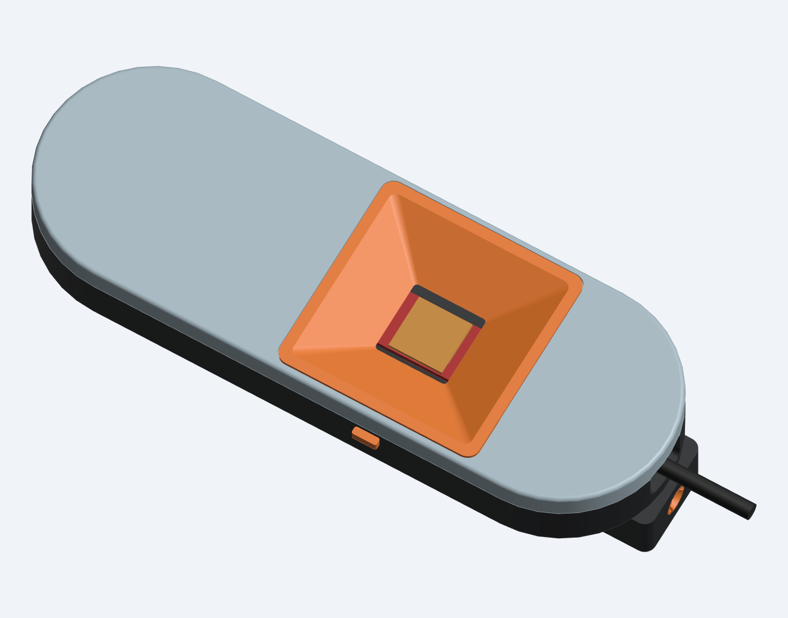
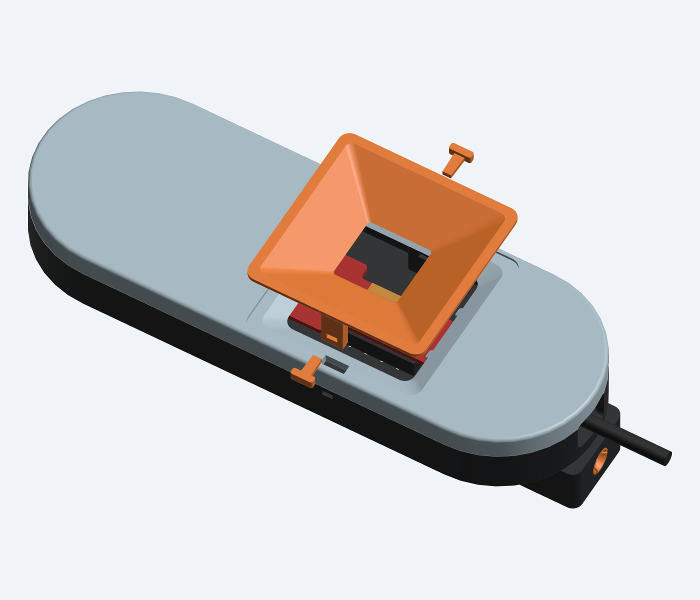
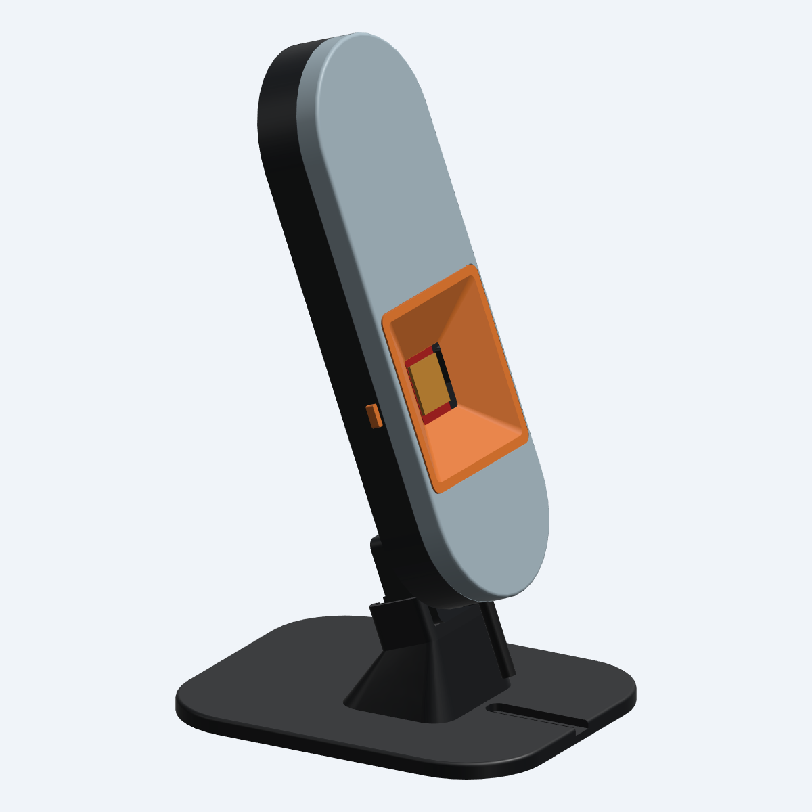

# Hardware-free single-board enclosure — v2 prototype

**2026-11-01, v2.1 rear-shell correction:** TP20, the upright ground test point, was missing from the original clearance model. The current rear adds a 6 mm through-opening under TP20, joining the adjacent vent. Reprint **only the rear shell** from `exports_v2_1/01_rear_TP20_clearance.stl` or its geometry-only 3MF. All other printed v2 parts and the tested 3.35 mm keys / 4.35 mm sleeve remain compatible. The board support height stays 10.4 mm. See `checks/tp20_report.json` for the local-change and clearance checks. The corrected rear still needs a physical dry fit.

A new matched enclosure for the TI IWR6843AOPEVM, with a sliding front and a separate flared aperture insert. The insert hides most of the exposed PCB while leaving the antenna package open. It is a cosmetic shroud, not a designed RF horn or focusing element.

The assembled case uses **eight printed pieces and no metal hardware or glue**: rear, front, shroud, two side keys, detachable heel, internal heel keeper, and one stand socket. It reuses the existing 20° desktop stand. This version has a smooth peg socket rather than a threaded microphone-arm mount. The v1 files remain available for the threaded version.

**Prototype status:** native-solid fit and motion checks and exported-mesh checks pass. The user printed and tested the fit coupons, selecting 3.35 mm keys and the 4.35 mm sleeve. The first full-shell fit exposed the missing TP20 clearance; v2.1 corrects that local opening. Full enclosure retention, the corrected physical fit, and radar performance remain unverified. See `FIT_TEST_NOTES_v2.md` for the observations.



## Cover and insert sequence

1. With the shroud and side keys removed, place the front onto the rear **6 mm toward the USB end** from its final position.
2. Slide the front **6 mm away from the USB end**. Four internal hooks engage the rear ledges. The pill outlines line up in the closed position.
3. Lower the shroud straight into the opening, perpendicular to the front face. Its flange seats in a shallow recess. Two broad **3 × 7 mm locating legs** pass through the front into the rear shell, preventing the front from sliding open.
4. Insert one printed key from each side. The keys pass through the legs and prevent the shroud lifting out. Choose the snug, removable key fit using the included trials. The keys rely on their printed sliding fit to stay inserted; they are not spring detents.

To open the enclosure, pull out both keys, lift the shroud, slide the front toward the USB end, then lift it. No adhesive is intended. Do not bond the shroud to the PCB or to the rear shell: it must lift out before the cover slides.



## Aperture geometry and board retention

| Feature | Nominal geometry |
|---|---|
| Pill body | 60 × 174 mm; widened from 52 mm to leave room for the flare |
| Main body depth | 21.844 mm, excluding the rear mounting heel |
| Shroud flange | 55.8 × 55.8 mm with rounded corners |
| Clear lower throat | 20 × 20 mm with 1 mm corner radii |
| Clear outer mouth | 50.09 × 50.09 mm with 2 mm corner radii |
| Flare depth | 8.85 mm from throat to mouth |
| Shroud wall | 1.6 mm in horizontal sections; about 0.81 mm normal to the straight sloping faces |
| Throat above PCB surface | 1.2744 mm |
| Throat above antenna package top | 0.3094 mm; throat edges are laterally outside the package |
| Closest shroud-to-package distance | 2.519 mm |
| Minimum shroud clearance to checked view envelope | 0.585 mm |
| PCB rear support height | 10.4 mm, unchanged |
| Nominal upper PCB capture clearance | 0.15 mm |

The field-of-view check projects a rectangular envelope outward at **±60° in both principal planes from the entire 15 mm antenna-package footprint**, rather than from a single point. No enclosure, insert, leg or key intersects that envelope. TI specifies 120° azimuth and elevation field of view for this EVM: [TI IWR6843AOPEVM specifications](https://www.ti.com/product/IWR6843AOPEVM/part-details/IWR6843AOPEVM).

This is a geometric clearance check, not proof of RF transparency. Nearby dielectric surfaces can still affect antenna behavior; compare recordings with and without the shroud. TI discusses material, proximity, reflection and radiation-pattern effects in its [radome design guide](https://www.ti.com/lit/an/swra705/swra705.pdf). The shroud stays above the PCB and does not load the chip. The mechanical reference uses the existing TI PROC091G outline and large-component envelopes; check unmodeled small components during the first dry fit.

The reinforced lower saddles and two locating pegs support and locate the board. Upper pads retain it with **0.15 mm nominal clearance**, rather than compressing it between rigid posts. This is captured retention, not a proven zero-rattle clamp. Check the actual board for movement; if it rattles or the cover does not close freely, adjust `PCB_CAPTURE_GAP` for the measured board and print. Do not force the lid against the PCB. Board position is independent of the decorative shroud.

## Print first: fit pieces

Open **`exports_v2/PRINT_FIRST_fit_coupons.3mf`**. It contains ten pieces and only geometry; select your own printer, filament and process settings. The STL version contains the same pieces. In the delivered XY layout:

- Along Y=25: a rear slide section, matching front section, shroud-leg receiver, and matching shroud-leg section.
- At Y=0, from X=-25 to X=5: socket trials with **4.35 / 4.50 / 4.65 mm** nominal bores.
- At X=25, from Y=-9 to Y=9: **3.05 / 3.20 / 3.35 mm** key-width trials.

Try the slide sections together before printing the full lid and rear. For the shroud coupon, align the side holes in the leg and receiver, then try the keys; the small coupon does not include the full lid seat, so hold the leg at the matching height. Use a key that stays in place but can be removed with fingers. Choose the socket that grips the existing stand's 4.5 mm pin with gentle hand pressure. The 4.35 mm option intentionally uses the slotted sleeve's compliance and is not a guaranteed fit. Do not force a sleeve onto the pin.

The coupon layouts are compact. Separate the objects farther apart if adding brims or support. The individual STL and STEP files are also provided.

## Full print set

All STL parts are already placed at Z=0 in their intended print orientation. Use 100% scale.

| File in `exports_v2/` | Quantity | Orientation / notes |
|---|---:|---|
| `01_rear_flat.stl` | 1 | Flat outside back on bed, cavity up |
| `02_sliding_front.stl` | 1 | Outside front on bed, internal pads up |
| `03_aperture_shroud.stl` | 1 | Wide mouth/flange on bed, throat and locating legs up |
| `two_locking_keys.stl` | 1 file | Contains **both** nominal keys; alternatively print `04_locking_key_single.stl` twice |
| `05_detachable_heel.stl` | 1 | Socket axis upright, mount entry at bed |
| `06_heel_keeper.stl` | 1 | Wide head on bed, square stem up |
| `07_socket_4p50_nominal.stl` | 1 | Flange on bed; substitute the snug or loose trial if that fit better |

If another key trial fits better, print **two of that individual key file** in place of the nominal pair. The pair file contains the 3.20 mm keys only. The tested socket and keys from the fit plate may be reused if undamaged. The slide and leg coupons are test pieces, not enclosure parts.

For the user's standard PLA and an assumed 0.4 mm nozzle, start with 0.20 mm layers, four wall loops and 30% infill; use five walls on the heel. These are proposed starting settings, not a tested Bambu profile. Inspect Preview to make sure the sloping shroud and small keys have continuous toolpaths. Fine layers around the slide surfaces may improve fit. Avoid automatic supports filling the vents, peg bore or key slots.

The flat rear eliminates support beneath the main back and vents. The short internal ledges and hook shoulders may still benefit from small manually painted supports if the coupon prints poorly. The upright heel needs support beneath the two outward stud-head shoulders; these supports are outside the socket passage and accessible for removal. The shroud, sleeve, keeper and keys are intended to print without supports in the supplied orientations. Verify these choices in the slicer; no printer-specific G-code is included.

## Assemble the heel and board

1. Insert the chosen stand sleeve into the detached heel from the heel's upper end. The sleeve's narrow end points toward the bottom mounting face; its flange stops against the internal shoulder.
2. With the rear shell empty, place the heel against the back, initially **7 mm toward the USB end**. Its two T-heads enter the large rear openings. Slide it 7 mm away from the USB end to engage the floor slots.
3. From inside the rear shell, lower the heel keeper through its square opening. Its head rests on the floor. The stem blocks both heel withdrawal and sleeve removal; the closed front prevents the keeper lifting out.
4. Place the PCB onto its supports with both locating pegs passing through the mounting holes. Check that it sits flat. Reuse the board and heatsink arrangement from the previous enclosure.
5. Plug in the straight USB cable and place it in the bottom route. The split stop captures the back of the plug boot, with a 5.5 mm cable passage. The modeled boot is 11 × 20 × 6 mm and cable diameter is 4.4 mm. A differently sized boot may need adjustment; do not close the cover onto a compressed cable.
6. Install the front, shroud and keys as described above. Test on the existing stand after checking the sleeve fit. The cradle carries the enclosure load; the pin locates it. Actual retention force and wear remain to be tested.



## Checks and editable files

`checks/v2_report.json` records native-solid validity, zero unintended overlaps against the modeled electronics and cable, PCB and seating distances, the ±60° clearance envelope, sampled assembly motions, positive geometric retention by hooks/keys/keeper, and nominal-socket insertion onto the existing stand. Motion checks sample the paths; they are not a dynamic simulation. The snug socket's intentional interference is excluded from the nominal clearance test.

`checks/mesh_v2_report.json` checks each delivered STL for closed edges, consistent winding, expected connected-part count, positive volume and every part resting at Z=0. STEP files accompany individual parts. Assembled STEP/GLB previews include electronics and cable references and are **not print plates**.

The model is in `src/enclosure_v2.py`, using the existing board geometry and helper modules. Rebuild with cadgen 0.8.4 from the `iwr6843aop` directory:

```sh
~/.local/bin/cadgen +0.8.4 run src/exports_v2.py
~/.local/bin/cadgen +0.8.4 run checks/check_v2.py
python3 checks/check_meshes_v2.py
```

This v2 front, rear and shroud form a new matched set. They do not interchange with the narrower v1 enclosure parts. The existing desktop stand is retained.
