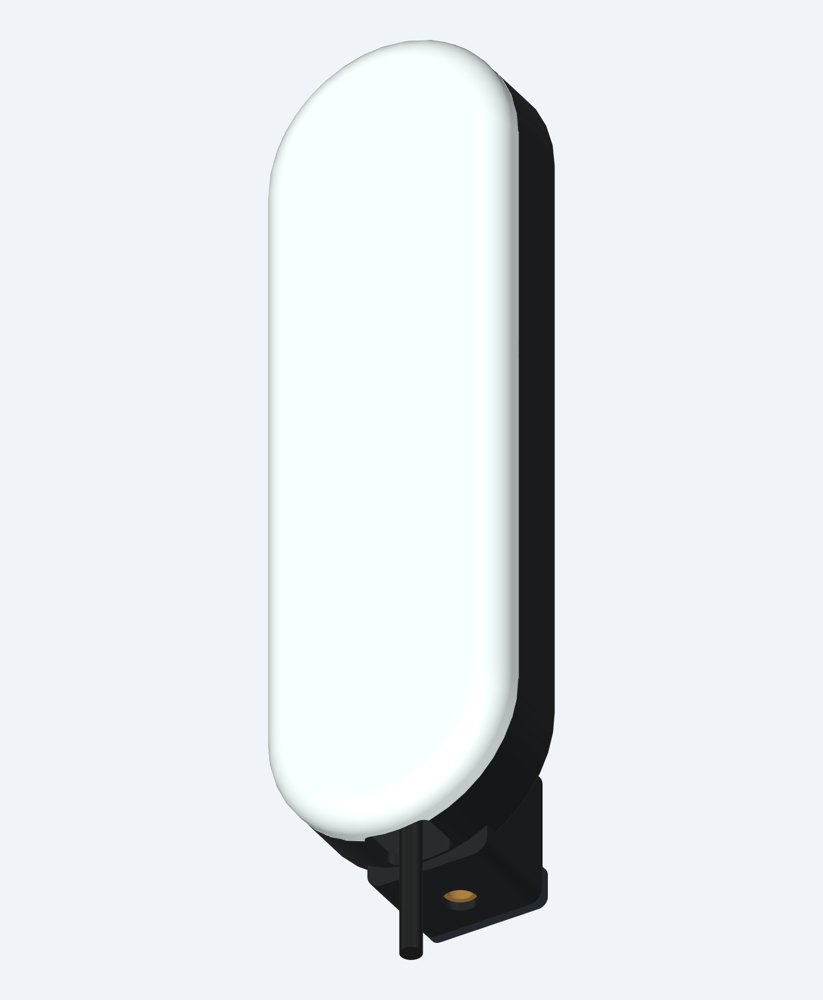

# IWR6843AOPEVM pill enclosure — prototype v1.2

Parametric CAD for an intact TI PROC091G / IWR6843AOPEVM Rev G board. Each enclosure uses three main printed parts and two small printed washers: your choice of front, the rear shell with board supports and integral arm-mount heel, and a small captive-nut retainer. The fronts are interchangeable: a solid radome or an open aperture over the antenna. The narrow end of the PCB points down; its J1 USB cable exits beside the downward-facing ¼″-20 socket. Units are millimetres.



## Changes in v1.2

Use the files in `exports_v1_2/`. The original v1.1 exports are retained separately under `exports/`.

- Rear tie slots are now 3.0 × 3.8 mm, with a wider anchor bridge, for common 2.5 mm nylon cable ties. Use a tie at least 150 mm long to comfortably route around the heel; trim after tightening.
- Two printable PCB washers replace the purchased washers: Ø4.4 outside, Ø2.3 bore, 0.6 thick. Print one `washer_print_pair.stl`, or two copies of `pcb_washer.stl`, flat at 0.20 mm layer height and 100% infill. Do not scale them. Inspect each bore; remove first-layer flare without enlarging the outside diameter. Tighten only until seated.
- Both fronts, nut retainer, screw sizes, inserts and arm-mount nut retain their original dimensions.
- `src/enclosure_v1_2.py` imports the original model and defines the revised rear, washers and assemblies. `src/exports_v1_2.py` regenerates this release.

## Files

- `src/enclosure.py`: editable build123d/cadgen model and dimensional parameters.
- `exports_v1_2/rear_shell.step`, `front_radome.step`, `nut_retainer.step`: exact solid parts. Prefer STEP when your slicer supports it.
- `exports_v1_2/front_open_aperture.step` and `.stl`: alternate front with a 42 × 44 opening, radius 3 corners, centred on antenna package U2. Use this in place of `front_radome`.
- Matching `.stl` files: one closed printable part per file except `washer_print_pair.stl`, which contains two washers. Main parts use assembly coordinates; orient and drop each onto the print bed before slicing. The washer pair is already flat at Z=0.
- `exports_v1_2/assembly_with_references.step`: assembled enclosure with simplified PCB, component, cable and metal-nut references. Print the three main part files plus the washer pair; do not print the reference assembly.
- `exports_v1_2/assembly_open_aperture_with_references.step`: assembly with the alternate front.
- `vendor/board_geometry.json`: PCB outline, mounting holes and critical component envelopes extracted from TI's board package. Required by the model; the full TI download is not needed to rebuild it.
- `checks/fit_report.json`: original assembly fit checks. `checks/v1_2_report.json` and `checks/mesh_v1_2_report.json`: revised geometry and exported mesh results.
- `checks/open_aperture_report.json`: aperture clearance and interchangeability checks.
- `renders/v1_2_rear_and_washers.png`: revised rear shell and printable washers.
- `renders/open_aperture_assembled.png`: view of the alternate front.
- `HARDWARE_v1_2.md`: hardware list, including quantities to equip both fronts.

## Dimensions and construction

| Feature | Dimension / arrangement |
|---|---|
| Main pill | 52 wide × 174 tall × 21.84 deep |
| Overall enclosure, including heel/retainer | 52 wide × 176 tall × 40.24 maximum depth; excludes cable and screw heads |
| Rear walls / floor | 2.4 |
| Radome face | 1.6 solid, with rounded perimeter; no ribs above the antenna |
| Alternate front | 42 × 44 open window, centred on U2; no plastic membrane, mesh or ribs across it |
| Antenna-to-inner-face gap | 7.253 nominal |
| Board underside height above rear outside face | 10.4 |
| PCB holes | Two Ø2.54 holes; 35.824 centre distance, positions taken from TI files |
| PCB supports | Two M2 insert standoffs plus four edge saddles |
| Cover fastening | Four M2.5 screws inserted from the rear into inserts in the front cover |
| Cover registration | Continuous locating tongue, 0.30 radial clearance |
| USB boot envelope | Straight plug, 11 wide × 20 long × 6 thick; Ø4.4 cable |
| Cable exit | Rounded 14 × 11 split opening; internal cable-tie anchor |
| Arm mount | Captive metal ¼″-20 UNC hex nut, axis pointing down |
| Mount entry | Nut starts 2.022 behind the bottom mounting face |
| Arm stud engagement | 5.478 with a 7.5-long projecting stud; a 6-long stud engages 3.978 |
| Arm shoulder clearance | A Ø25 shoulder clears the assumed cable by 2.255 |
| Heatsink envelope | 17.6 × 30 × 5.8; minimum clearance to shell 2.2 |

The mount is behind the USB cable so both can leave the bottom. The nut loads through the rear slot and the small screwed plate retains it. Threads are supplied by the metal nut; the CAD nut has a schematic bore rather than modeled helical threads. The enclosure is intended for standalone USB operation; it has no access for an external MMWAVEICBOOST/DCA1000 or an additional J5 power cable with the cover fitted.

## Hardware

| Quantity | Item | Purpose |
|---|---|---|
| 1 | ¼″-20 UNC hex nut, 7/16″ (11.1125) across flats, 7/32″ (5.556) thick | Arm mount; trap is 11.5 across flats × 6 deep |
| 4 | M2.5 × 16 button-head screws, head diameter ≤5.2 | Join shell and cover |
| 4 per front; 8 for both | M2.5 heat-set inserts, Ø3.5 OD × 4 long | Cover; printed receiving bore Ø3.3 |
| 2 | M2 × 6 screws, low-profile heads | PCB mounting |
| 2 | M2 × 6 screws | Nut-retainer plate |
| 4 | M2 heat-set inserts, Ø3.2 OD × 4 long | PCB posts and retainer; printed receiving bore Ø3.0 |
| 2, printed | PCB washers, Ø4.4 OD × Ø2.3 bore × 0.6 thick | Under PCB screw heads; included STL |
| 1 | Nylon cable tie, 2.5 mm wide and at least 150 mm long | Restrain the USB boot; do not strain the socket |

Insert receiving holes are nominal interference fits. Match the insert supplier's recommended pilot size to your material/printer and adjust `M2_INSERT_BORE` or `M25_INSERT_BORE` if needed. Do not substitute a wide-head insert without checking boss wall thickness. A microphone arm with a 3/8″ or 5/8″ end needs an adapter to a male ¼″-20 stud. Aim for 6–8 mm of projecting thread and tighten by hand; printed plastic is the load-bearing structure around the nut.

## Printing and assembly

Starting print settings: 0.4 mm nozzle, 0.16–0.20 mm layers, four perimeters, and locally solid infill around the mount and screw bosses. These are starting settings, not a tested printer profile. PETG or ASA can be used for a body prototype; confirm its temperature margin in operation.

The radome's 1.6 mm face must print as a solid, uniform wall. Use unfilled, nonconductive material without metal or carbon additives and leave the front unpainted. The thickness is a first RF tuning value based on relative permittivity near 2.3 at 62 GHz. A particular filament's pigment, voids, moisture and dielectric properties can change the result. The 7.253 mm gap is three free-space half wavelengths at 62 GHz; neither this gap nor the wall has been validated by RF simulation or measurement.

- Front: outer face toward the bed, skirt and bosses upward. Inspect the rounded perimeter in the slicer and support the steep initial overhang if needed; keep support off the antenna-facing inner surface.
- Rear: cavity upward. The integral heel projects behind the body, so this orientation requires support under the raised rear floor/spine. Use removable support with a suitable interface; clear the vents, insert bores, cable-tie slots and nut pocket afterward. This part is not support-free.
- Retainer: flat outer face on the bed, locating pad upward.

1. Dry-fit the printed tongue, actual nut, actual USB plug and PCB before installing inserts. Check the full board outline is about 115.3 × 25.3 and that its two mounting holes align. Rev G is the design basis; confirm the physical board revision before building.
2. Install the four M2.5 inserts in the cover from its open side. Install two M2 inserts in the PCB posts from the inside and two in the heel from the rear. Keep inserts flush; do this with the electronics removed.
3. Insert the metal ¼″-20 nut through the heel's rear loading slot. Fit the retainer with its locating pad inward and its two M2 × 6 screws. Check that an arm stud threads freely before mounting the electronics.
4. Feed the cable tie through its two slots and around the back of the heel before the board is installed. Leave it loose. Connect the straight USB plug to J1, place the board antenna side toward the cover, and secure its two mounting holes with M2 × 6 screws and the included printed washers. The edge saddles support the remaining PCB margins. Retain the board's heatsink.
5. Gently restrain the plug boot with the tie. Route the cable through the bottom opening. Place the cover over the locating tongue and install the four M2.5 × 16 screws from the rear. Snug the screws without bending the PCB or crushing the shell.
6. Mount on the arm. Check cable freedom at the arm's full range of motion and check the enclosure temperature and radar readings under the intended workload.

The rear provides ventilation and an S3 access aperture. Removing the front exposes the other switches. The enclosure has no weather seal or ingress rating. The open front exposes the antenna package directly; leave its opening uncovered for the intended comparison. Swapping fronts requires removing the four rear cover screws; the PCB, rear shell, nut mount and cable can remain in place.

## Verification and limits

The delivered CAD passes checks for one valid closed solid per printed part, no intersections between the printed parts and modeled board/component/cable envelopes, touching PCB supports, aligned fastener clearances, nut insertion and Ø25 arm-shoulder clearance. The antenna gap and centre wall thickness were measured on the built solids. Each of the five individual-part STL meshes is watertight with consistent winding and one connected surface. The washer-pair STL contains two closed connected components.

The alternate front retains all four original fastening bosses and the mating skirt. Its opening clears the full modeled 15 × 15 antenna package projection and a geometric envelope expanding at 50 degrees from each package edge toward the outside. That is a geometric clearance check, not a measured RF field of view. Surrounding plastic can still affect off-axis RF behaviour.

The PCB outline and mounting-hole positions come from TI's fabrication data. Component bodies, the heatsink and cable are clearance envelopes, not a complete vendor 3D assembly. No physical print, hardware load test, temperature test or RF test has been performed. Compare covered versus uncovered radar performance and monitor temperature with the actual board, material and workload. Adjust the cable envelope if the plug exceeds the dimensions above. This is a prototype fit release.

## Rebuild

With text-to-cad/cadgen 0.8.4 installed, run from this project folder:

```sh
cadgen +0.8.4 run src/enclosure_v1_2.py
cadgen +0.8.4 run checks/check_v1_2.py
cadgen +0.8.4 run src/exports_v1_2.py
```

The script prints the revised rear, washer, washer-pair, both assembly and changed-parts model IDs. Export updated parts from their model documents; existing STEP/STL files are detached copies and do not update automatically. The mesh results for this release are recorded in `checks/mesh_v1_2_report.json`.

## Design references

- [TI IWR6843AOPEVM product page](https://www.ti.com/tool/IWR6843AOPEVM).
- [TI SPRR418A board design package](https://www.ti.com/lit/zip/sprr418): Rev.G PROC091G ODB outline, round-hole drill table and Altium component envelopes; retrieved 2026-10-30. The source revision is dated 2021-09-02.
- [TI SWRU546E user guide](https://www.ti.com/lit/ug/swru546e/swru546e.pdf), chapter 4: Rev G board arrangement, USB operation, heatsink and thermal guidance.
- [TI SWRA705 radome design guide](https://www.ti.com/lit/an/swra705/swra705.pdf): material, wall-thickness and antenna-spacing considerations used for the initial radome parameters.

## v1.2 verification

`checks/v1_2_report.json` verifies the revised rear against all modeled components, a 2.8 × 3.4 mm through-slot gauge, washer-to-PCB contact, zero washer/component overlap, and 3.7744 mm of M2 screw engagement. `checks/mesh_v1_2_report.json` verifies closed, consistently wound individual STL parts. The washer-pair export contains two copies. Printed washers are a prototype substitute and have not been physically or thermally tested. The original board, filament and cable fit assumptions still apply.

## Desktop dock

For tabletop use, add the [drop-in desktop dock](DESKTOP_STAND.md). It supports either front at a fixed 20° upward aim without additional metal hardware. It uses gravity and a smooth locating pin, with no latch or threaded lock. See [all enclosure options](../../docs/ENCLOSURES.md) for the separate three-board capture case.
