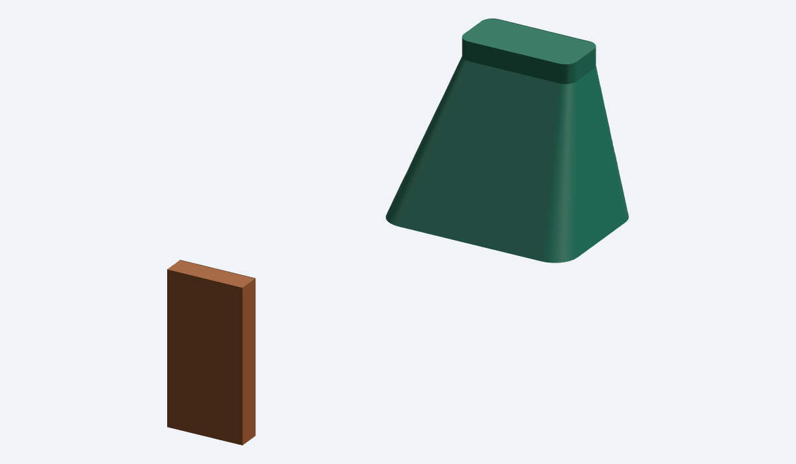
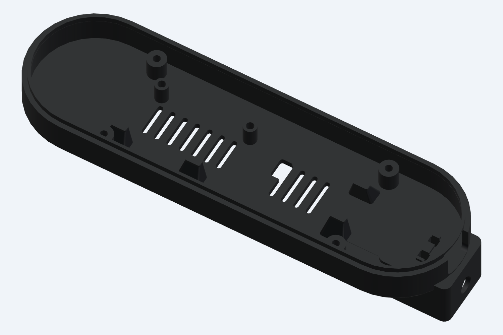
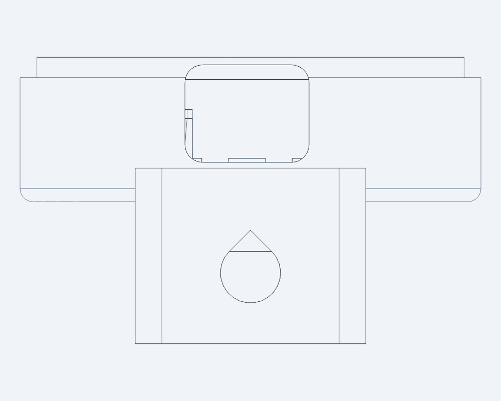

# Single-board pill enclosure — v1.3 rear-shell update

This revision addresses the physical print feedback from black PLA in Bambu Studio: one thin rectangular board support snapped, and automatic tree supports were difficult to remove around the rear vents and ¼″-20 opening.

**Print only `exports_v1_3/rear_shell_reinforced.stl`.** Reuse your existing front, nut retainer, printed washers, metal hardware and tabletop dock. The earlier enclosure files and archives are preserved.

## What changed

- All four rectangular board-edge supports now have **2.8 × 6 mm upper pads**, replacing the 1.2 × 4 mm blades. Each widens into a rounded, tapered root about **6.8 × 10 mm** at the rear floor. Added width grows outward from the board; the contact height remains 10.4 mm. The root beside a cover screw column preserves the original screw bore.
- The ¼″-20 access passage keeps its original Ø6.8 mm circular clearance and gains a **45° roof** above the circle. This reduces the unsupported curved ceiling when printed cavity-up. It is still a clearance passage to the existing captive metal nut; the nut supplies the threads.
- The vents keep their original dimensions. Support removal around them is addressed by selecting support contact areas in Bambu Studio, rather than filling the holes with automatic trees.





The end view below shows the sloped roof above the round mount clearance. The circular part still admits the existing ¼″ stud and the dock's locating pin.



## Files

| File | Use |
|---|---|
| `exports_v1_3/rear_shell_reinforced.stl` | Print **one**; already oriented cavity-up with the heel at Z=0 |
| `exports_v1_3/rear_shell_reinforced.step` | Same printable part and orientation, as an exact solid |
| `exports_v1_3/rear_shell_assembly_coordinates.step` | Reference part in the old assembly coordinate system |
| `exports_v1_3/assembly_with_references.step` / `.glb` | Assembled preview with board and cable envelopes; do not print this assembly |

The print envelope remains **52 × 176 × 32.3 mm**. This is a replacement rear shell; no drilling, front modification or new hardware is specified. Reuse the v1.2 assembly instructions and hardware counts. Keep the PCB flat on its supports and tighten its screws only until seated.

## Bambu Studio setup for this revision

The heel still projects behind the rear floor, so **this part still needs external supports**. Import the new STL at 100% scale, keep the cavity facing up, and keep the heel on the bed. Do not use Lay on Face on the raised rear floor: the projecting heel is below it.

Use your existing printer and black-PLA profiles. For a 0.4 mm nozzle, these are starting values for the next trial, not a tested printer preset:

| Setting | Starting point |
|---|---|
| Layer height | 0.20 mm |
| Wall loops | 5; check that the narrow support pads become solid in Preview |
| Infill | 30–40%; solid locally around the saddle roots and mount if needed |
| Enable support | On |
| Support type | **tree(manual)** |
| On build plate only | On |
| Top Z distance | **0.30 mm** for easier PLA-on-PLA removal; expect a rougher supported underside |
| Support/object XY distance | **0.40 mm** |
| Top interface layers | 2 |

These gaps are proposed tuning values, not Bambu defaults. The effective Z gap can be rounded depending on support-layer settings. Keep your proven PLA temperatures, speeds and cooling initially so the next print changes fewer variables.

1. Open support painting and rotate the view to see the **outside underside**. Enforce support on the raised, flat rear floor and the underside of the short reinforcing spine above the heel. Cover the solid floor bands between and beside the vents, with small brush strokes that stay on the actual exterior surface.
2. Leave the inside of the shell and the tops of the PCB supports unpainted. Block support on the **interior surfaces of the vent slots, ¼″ access passage, hex nut pocket, insert holes and cable-tie slots**. The new sloped passage roof is intended to print without internal support.
3. Slice and inspect the support layers in Preview. Support contacts should stop at the outer rear floor/spine, and the openings must remain clear. If branches enter a vent or the mount opening, adjust the blocked/enforced regions before printing. Selecting manual support with no painted/enforced areas will not generate the external support the raised floor needs.
4. Let the print cool completely before removal. Work on the outside support structure in small sections. Avoid using the PCB supports or vent edges as levers while removing support. Do not force the metal nut into a pocket with leftover strands.

Bambu's [support configuration definitions](https://github.com/bambulab/BambuStudio/blob/master/src/libslic3r/PrintConfig.cpp) document manual support as using only enforcers, define the Z/XY separation controls, and note that small XY spacing makes supports difficult to remove. [Bambu's printer manual, support section](https://csm.bblcdn.com/hub/4668d0ca43994ff3bff4b37f1a65c2e7.pdf) explains the build-plate-only option. The dimensions and tuning values above are specific design choices for this prototype.

## Verification and limits

The included `checks/v1_3_report.json` measures the four new upper pads, PCB support contact, clearance against the modeled board and component envelopes, the original fastener bores, metal-nut loading and retention, and compatibility with the printed front, retainer and drop-in dock. It also checks that added material is confined to the four supports and removed material is confined to the mount roof. `checks/mesh_v1_3_report.json` checks the delivered STL for closed edges, winding, connectivity and positive volume.

The revision has not yet been physically printed or strength tested, and no printer-specific slice is included. The new support proportions should be less fragile, but the actual improvement and support release need confirmation with your printer. The previous thermal and RF caveats still apply to the enclosure.

## Rebuild

Run from the `iwr6843aop` folder with cadgen 0.8.4:

```sh
~/.local/bin/cadgen +0.8.4 run src/enclosure_v1_3.py
~/.local/bin/cadgen +0.8.4 run checks/check_v1_3.py
~/.local/bin/cadgen +0.8.4 run src/exports_v1_3.py
python3 checks/check_meshes_v1_3.py
```

`src/enclosure_v1_3.py` composes the existing enclosure modules. `SADDLE_TOP_WIDTH`, `SADDLE_TOP_LENGTH`, `SADDLE_ROOT_WIDTH` and `SADDLE_ROOT_LENGTH` control the reinforcement. Recheck component and screw clearances after changing them.
