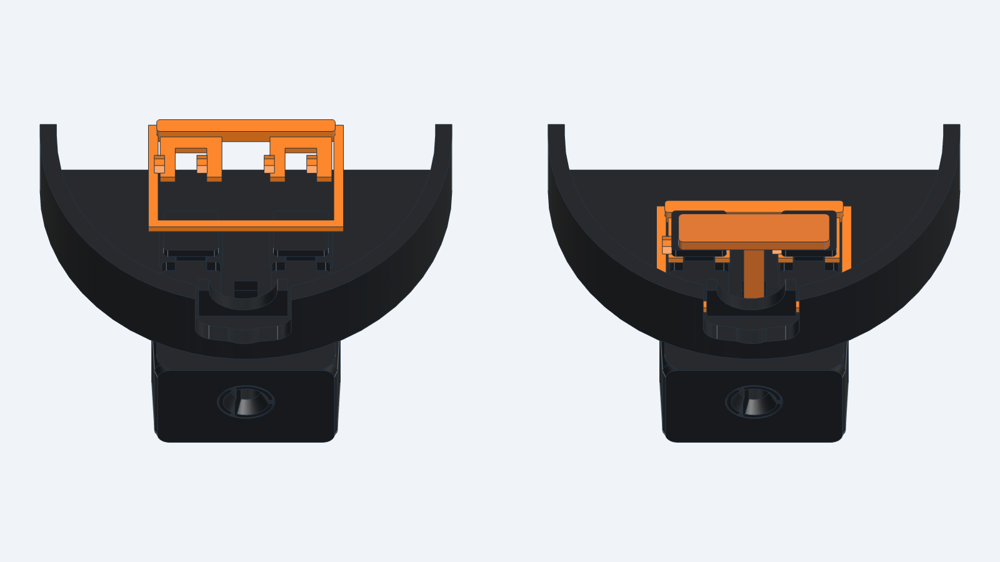
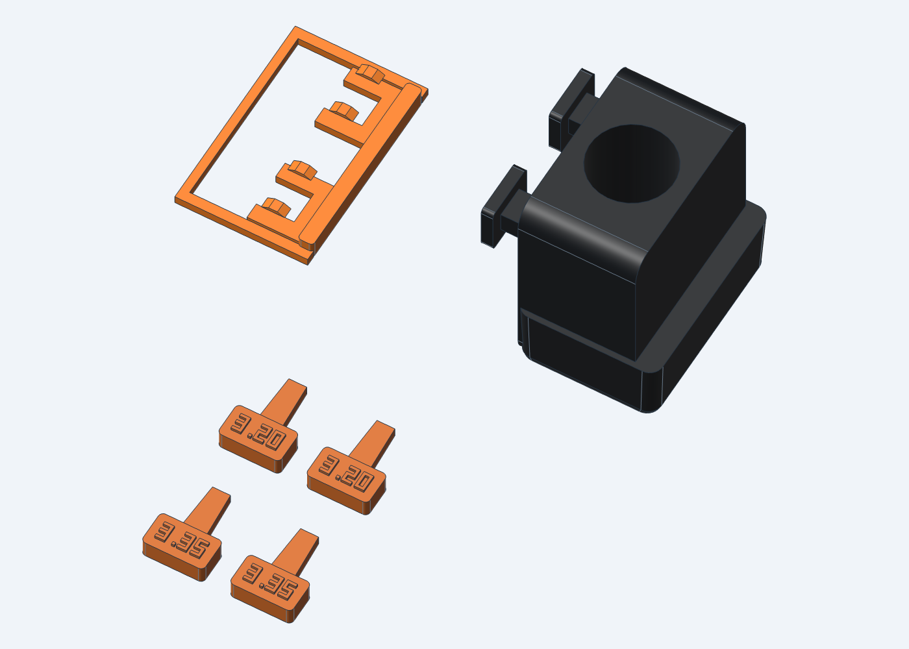

# v2.2 — cable clearance and firmer stand connections

Print at 100% scale. These 3MF files contain geometry and placement, not a Bambu printer profile or sliced toolpaths.

## What to print

1. **`PRINT_FIRST_mount_and_keys.3mf`** — six pieces: one new fitted mounting block, one preload clip, two keys marked **3.20**, and two marked **3.35**. First test the new block directly on your existing stand and try the marked keys in your existing assembled horn. Save the clip for the new rear shell; its springs require the new shell's relief pockets.
2. **`REPRINT_case_pair.3mf`** — one revised rear and one revised sliding front. This pair is about 130 × 174 mm on the bed. Print after the small mount fits the stand satisfactorily.

Reuse your **existing horn, tabletop stand and T-shaped keeper**. The old mounting block and separate 4.35 mm sleeve are replaced by the new block, which has that socket built in. The two extra keys are alternatives, not additional assembly parts. Start with the 3.20 pair; use the 3.35 pair if the smaller keys do not stay seated. Do not force a key that jams.

Individual STL and STEP files are provided beside the plates. The `REUSE_existing_parts` folder contains optional duplicates of the unchanged horn and keeper if one needs replacement. Do not print the assembly STEP/GLB files; they include reference electronics and the stand.

## Print setup

Use your standard black PLA and the same calibrated scale/flow settings as the earlier fit tests. All files already have their intended print orientation.

- **Small plate:** use 0.10 mm layers to resolve the clip's small contact ramps, four walls and 40% infill. The keys and clip will be essentially solid with these walls. The clip lies flat and requires no supports.
- **Mount block:** keep the socket axis vertical as supplied. Inspect the preview under its two projecting T-head shoulders; use small painted supports there if needed. Keep support out of the socket bore, the three slots and the narrow gap around the socket fingers. The short annular bridge above those fingers is intentional.
- **Case pair:** 0.20 mm layers and four walls; rear outside face down, front outside face down. **Support the front's angled radar-opening walls and the horizontal underside of its recessed horn seat**, as well as the underside of the four slide-hook lips. Use Normal (manual) supports and paint these areas; inspect the sliced preview for coverage. For PLA supporting PLA, start with a 0.20 mm top Z gap. Keep supports out of narrow key slots and avoid unnecessary support in the rear vents, TP20 opening and cable passage. Do not flip the front onto its posts. The earlier instruction mentioning only the hooks was incomplete.
- Use one filament for all pieces; the CAD colors identify components and do not require multicolor printing.

## Assemble the mounting joint before installing the board or USB cable

1. Put the new rear cavity-up. Feed the new block's two T-heads through the wide entries in the rear, then slide the block **7 mm away from the USB end** until its necks reach the ends of the narrow slots.
2. Orient the new preload clip with its **raised ramps facing up**, thick handle toward the board, and its long rectangular frame extending toward the USB exit. Initially lower it about **7.4 mm toward the board from its final position**: the heads sit inside the openings in the frame, just ahead of the four fork tips. Then push the clip **toward the USB end**. Its four tips slide under the T-heads; the raised pads gently take up slack. The handle ends immediately on the board side of the heads. Stop if it requires force or a spring visibly folds.
3. Drop the **old T-shaped keeper** through its original square hole, inside the clip frame near the USB end. The keeper stops the mounting block withdrawing and catches the clip's rear crossbar. The new front later holds both down. Never omit the keeper.
4. Install the board on its unchanged supports, with TP20 entering the clearance opening. Fit the straight USB plug and lay its molded strain relief in the enlarged cable passage.
5. Drop the front on with its usual 6 mm offset toward USB, then slide it closed. Insert the existing horn vertically. Insert two matching labeled keys from the sides.
6. Lower the new mounting block fully onto the existing stand. The shaped foot should sit on the cradle floor; the integrated split socket grips its peg. No loose sleeve is inserted.

For disassembly: lift the enclosure from the stand, remove the two keys and horn, open the front, remove the board/cable as needed, lift the T-keeper, slide the clip toward the board and lift it out, then slide the mounting block toward USB and withdraw it. Do not pry the block against the locked keeper.

## What changed and what is verified

- Cable passage: **5.5 → 10.0 mm**, to clear a molded strain relief. A 9 mm diameter × 12 mm strain-relief envelope is an assumption; the actual cable has not been measured. The original plug boot allowance remains 11 × 20 × 6 mm.
- Horn keys: **1.5 → 1.4 mm** blade thickness, narrower lead-in, larger grips and embossed size labels. The horn, its receivers, radar clearance and sliding rails are unchanged.
- Stand end: the new foot follows the existing cradle taper with about **0.15 mm clearance at each side and behind it**. The tested 4.35 mm split socket is integrated into the block so a loose outer sleeve cannot contribute play.
- Body end: wider 4.3 mm mounting necks and a separate clip with **0.10 mm nominal spring preload** under both T-heads. Shallow 0.2 mm pockets in the new rear allow the arms to flex; the outside back remains flat. The old keeper remains the positive slide-out retainer.
- The 6 mm TP20 relief and 10.4 mm PCB support height are preserved.

`checks/v2_2_report.json` records the native-solid checks: valid closed single-solid parts; no unintended interference with modeled electronics/cable or the radar keepout; sampled lid, horn, key, mount, clip, keeper and stand assembly motions; 10 mm passage gauge; stand seating and measured shoe clearances. The socket/peg interference and clip/head preload are deliberate elastic fits and are reported separately. The STL/3MF report records watertight meshes, quantities and bed placement.

**This revision has not been physically printed or tested.** CAD checks do not establish insertion force, PLA creep, fatigue life or RF performance. The existing stand remains gravity/friction retained, with no positive lift latch; lift the assembly by its stand base if you want to carry both together.

Support clarification, 2026-11-01: measurements on the exact front STL (`checks/front_v2_2_dfam.json`) identify 30.5-degree downward-facing aperture walls, measured from horizontal, plus horizontal ledges 0.89 mm above the bed. These are below the conservative 45-degree FDM self-supporting limit in the CAD plugin's `dfam-check/references/process-limits.md`. Flipping onto the posts raises the below-limit surface area from 1829 to 8063 mm²; an upright orientation reduces it to 1166 mm² but increases build height from 17.29 to 173.87 mm (`checks/front_v2_2_orientations.json`). Keep the supplied orientation and add local supports. These are geometric support estimates, not a sliced support plan. Bambu's manual describes manual support painting and recommends about 0.20 mm top Z separation for same-filament supports: https://csm.bblcdn.com/hub/4668d0ca43994ff3bff4b37f1a65c2e7.pdf, printed pages 60 and 65.

The previous `exports_v2`, `exports_v2_1` and `PRINT_SELECTED_v2` folders are historical versions and have not been replaced by these files.

